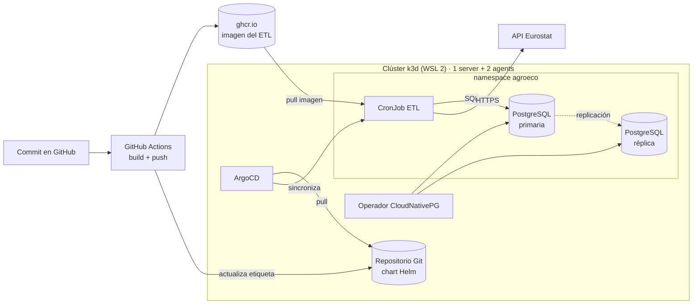

# Agroeco-EU K8s Platform

Migración del pipeline ETL de agricultura ecológica de la UE
([Agroeco-EU Cloud Pipeline](https://github.com/SamAnaya11/Agroeco-EU_Cloud-Pipeline),
serverless en Azure) a una plataforma Kubernetes con PostgreSQL gestionado
por operador, empaquetado con Helm, despliegue GitOps y CI/CD.

> Estado: en construcción (Fase 2 – PostgreSQL con CloudNativePG).

## Qué hace

Cada mes, un CronJob de Kubernetes ejecuta el ETL:

1. **Extracción**: descarga cuatro tablas de la API pública de Eurostat
   (superficie ecológica por cultivo, % de SAU ecológica, operadores y ganadería).
2. **Transformación**: limpieza con pandas y modelo en estrella (2 dimensiones y 4 hechos).
3. **Carga**: PostgreSQL de alta disponibilidad (primaria y réplica) gestionado por CloudNativePG.

## Arquitectura



## Stack

_(Se completará con las versiones exactas verificadas en cada fase.)_

| Componente | Herramienta | Versión |
|------------|-------------|---------|
| Entorno | Ubuntu 26.04.1 LTS sobre WSL 2 | — |
| Contenedores | Docker Engine (WSL 2) | 29.10.0 |
| Kubernetes local | k3d / k3s | 5.9.0 / v1.37.2+k3s1 |
| Cliente Kubernetes | kubectl | v1.37.2 |
| Paquetes | Helm | v4.3.2 |
| Operador de base de datos | CloudNativePG (chart `cloudnative-pg`) | 1.30.2 (chart 0.29.2) |
| Base de datos | PostgreSQL (`ghcr.io/cloudnative-pg/postgresql:18.7-minimal-trixie`) | 18.7 |
| CLI de base de datos | Plugin `kubectl cnpg` | 1.30.2 |
| GitOps | ArgoCD | — |
| CI/CD | GitHub Actions + ghcr.io | — |

## Decisiones técnicas

- **Kubernetes 1.37 con CloudNativePG 1.30.** Según la
  [tabla de versiones de CloudNativePG](https://cloudnative-pg.io/documentation/current/supported_releases/),
  la serie 1.30 da soporte oficial a Kubernetes 1.34, 1.35 y 1.36. La 1.37
  figura como *«tested, but not supported»*: los mantenedores la prueban, pero
  no la cubren formalmente. Para este entorno de demostración se mantiene
  k3s v1.37.2, alineado con la versión estable actual de Kubernetes y de
  kubectl. **En producción se usaría una versión de Kubernetes con soporte
  oficial del operador.**
- **Imagen `minimal` de PostgreSQL.** CloudNativePG 1.30.2 usa por defecto la
  imagen `system`. Esas imágenes están marcadas como obsoletas, porque incluyen
  Barman para el método `barmanObjectStore`, también obsoleto. Se fija la
  imagen `minimal`: es la más ligera y la recomendada para usar con
  plugins de backup como el Barman Cloud Plugin.
- **PostgreSQL 18, no 19.** CloudNativePG 1.30 admite PostgreSQL de la 15 a la 18.
- **Clúster PostgreSQL de 2 instancias en nodos distintos**
  ([`k8s/04-postgres-cluster.yaml`](k8s/04-postgres-cluster.yaml)): una
  primaria y una réplica en *streaming replication*, con antiafinidad
  obligatoria por nodo. La base de datos y su propietario se crean con el
  mismo Secret `basic-auth` que usa el ETL. El superusuario no tiene acceso
  por red. Este diseño local tiene dos limitaciones aceptadas:
  1. **Volumen atado a su nodo.** Con `local-path` el disco está en el nodo
     de la instancia: un pod borrado se recrea en el mismo nodo, pero si el
     nodo desapareciera esa instancia no podría moverse. En AKS se usaría un
     disco gestionado de Azure, que puede moverse entre nodos de la misma zona.
  2. **Memoria solicitada inferior al límite** (256 Mi frente a 512 Mi). En
     producción, CloudNativePG recomienda que sean iguales, para que
     Kubernetes no expulse a PostgreSQL cuando el nodo va justo de memoria.
     Aquí se reserva menos para ahorrar memoria en WSL.
- **Raw y processed en un volumen `emptyDir`.** Sustituyen a Blob Storage con
  la misma estructura por fecha. El destino persistente de los datos es
  PostgreSQL.

## Requisitos

- Windows 11 con WSL 2 (Ubuntu) y systemd activado.
- Docker Engine, k3d, kubectl y Helm instalados **dentro de WSL**.
- Recursos asignados a WSL: ver `.wslconfig` en [Reproducción](#reproducción).

## Reproducción

_(Pendiente.)_

## Validación de la carga

El mismo ETL se validó en dos entornos: primero con `docker run` contra un
PostgreSQL 18.7 local, con el sistema de archivos raíz en solo lectura como
en Kubernetes, y después como Job en el clúster contra CloudNativePG, a través
del Service `agroeco-pg-rw`.

| Tabla | Docker local | Kubernetes (primaria) |
|-------|-------------:|----------------------:|
| `dim_pais` | 28 | 28 |
| `dim_cultivo` | 17 | 17 |
| `fact_superficie` | 13 529 | 13 529 |
| `fact_pct_sau` | 620 | 620 |
| `fact_operadores` | 2 015 | 2 015 |
| `fact_ganaderia` | 1 395 | 1 395 |

- **Vista `v_superficie_total`:** superficie ecológica de España de
  2 944 904 ha en 2024, 2 991 881 ha en 2023 y 2 675 331 ha en 2022.
- **Duración del Job:** 13 s, de la descarga de Eurostat a la carga confirmada.
- **Réplica:** la consulta en `agroeco-pg-2` devuelve los mismos 13 529 registros
  de `fact_superficie` con `pg_is_in_recovery() = true`. Los datos se replican
  y la réplica es de solo lectura.
- **Conexión cifrada:** con `PGSSLMODE=require` y `log_connections=on`, el log
  de la primaria registra la conexión del ETL:

  ```
  connection authorized: user=agroeco database=agroeco application_name=agroeco-etl
  SSL enabled (protocol=TLSv1.3, cipher=TLS_AES_256_GCM_SHA384, bits=256)
  ```
- **Configuración aplicada sin interrupción:** activar `log_connections` en el
  Cluster no reinició ninguna instancia (`RESTARTS 0`). El operador recargó la
  configuración.

Capturas: `13a_consulta_datos.png` (recuentos, vista y réplica) y
`13b_conexion_tls.png` (conexión TLS en el log de PostgreSQL).

> Nota: consultado justo al terminar el log, el Job aún figuraba como
> `Running 0/1` y segundos después pasó a `Complete 1/1`. Desde Kubernetes
> 1.31, el controlador añade la condición final de un Job solo cuando todos
> sus pods han terminado del todo.

## Resultados de los experimentos

| Exp. | Qué demuestra | Resultado |
|------|---------------|-----------|
| A | Autocuración de pods | ✅ El Job sustituye al pod borrado sin intervención y termina `Complete` |
| B | Job/CronJob frente a Deployment | ✅ Como Deployment, el ETL termina bien (código 0) y aun así se reinicia en bucle (`CrashLoopBackOff`) |
| C | Failover de PostgreSQL | ✅ La réplica pasa a primaria 5,7 s después de borrar la primaria; el cliente vuelve a leer los mismos datos sin cambiar su configuración |
| D | Mismo chart, distintos entornos | _pendiente_ |
| E | GitOps: corrección de drift y despliegue desde Git | _pendiente_ |
| F | Alerta ante fallo del Job | _pendiente_ |
| G | Limpieza completa | _pendiente_ |

### A · Autocuración

**Procedimiento.** Con el Job `agroeco-etl-manual` en ejecución, se borra su pod
(`kubectl delete pod`) y se observa con `kubectl get pods -w`.

**Resultado.**

- El pod borrado (`…-vv8b9`) pasa a `Terminating` y, en lugar de morir a
  mitad de la ejecución, termina en `Completed`.
- El controlador de Jobs crea por su cuenta un pod nuevo (`…-sn8mv`), que
  recorre `Pending` → `ContainerCreating` → `Running` → `Completed`.
- En los eventos del Job aparecen dos `SuccessfulCreate`, uno por pod, y la
  condición final `Completed`.
- Una segunda ejecución, con marcas de tiempo, confirma el comportamiento:

  | Momento (UTC) | Evento |
  |---------------|--------|
  | 14:17:29 | `Killing`: se borra el pod `…-zblft` |
  | 14:17:38 | `SuccessfulCreate`: el Job crea el pod `…-n8qb7` (**9 s después**) |
  | 14:17:47 | El Job queda `Completed` |

  Estado final del Job: `podReplacementPolicy: TerminatingOrFailed`,
  `succeeded: 1`, `failed: 1`.

Capturas: `08a_exp_A_autocuracion.png` (secuencia) y `08b_exp_A_autocuracion.png`
(eventos), de la primera ejecución; `08c_exp_A_tiempos.png` (eventos con hora y
política de reemplazo), de la segunda.

**Por qué el pod borrado llegó a terminar.** Al borrar un pod, Kubernetes envía
`SIGTERM` al proceso principal del contenedor y, si no ha salido al cabo del
periodo de gracia (`terminationGracePeriodSeconds`, 30 s por defecto), lo
mata con `SIGKILL`. En el contenedor del ETL, `python main.py` es el **PID 1**.
El kernel de Linux no aplica la acción por defecto de una señal (terminar) al
PID 1 de un espacio de nombres si el proceso no ha instalado un manejador, y
Python no instala ninguno para `SIGTERM`. Por eso la señal se ignoró y al ETL
le dio tiempo a acabar dentro de los 30 s de gracia. Si la ejecución hubiera
necesitado más tiempo, `SIGKILL` lo habría cortado. La integridad de los datos
estaría igualmente garantizada, porque toda la carga es una única transacción
y PostgreSQL deshace las transacciones que no llegan a confirmarse.

**Por qué el pod nuevo tarda unos 10 s.** La política por defecto
`podReplacementPolicy: TerminatingOrFailed` permite crear el reemplazo en cuanto
el pod borrado tiene `deletionTimestamp`, sin esperar a que termine. El retraso
no viene de esa política, sino del **retraso exponencial de reintentos** del Job:

1. Sin `podFailurePolicy`, el controlador cuenta un pod en borrado como
   **fallido en el mismo momento**, aunque después termine en `Succeeded`. Por
   eso el Job acaba con `failed: 1`, y ese intento consume uno de los
   reintentos de `backoffLimit`.
2. Tras un fallo, el controlador espera antes de crear el siguiente pod:
   10 s después del primer fallo, y el doble en cada fallo siguiente
   (20 s, 40 s…), hasta un máximo de 10 minutos.
3. Ese retraso se aplica a cualquier pod que falte, también a los de
   `TerminatingOrFailed`. El cálculo parte del momento en que se pidió el
   borrado, y eso cuadra con los ~9-10 s medidos.

Verificado en la [documentación de Jobs](https://kubernetes.io/docs/concepts/workloads/controllers/job/)
y en el código del controlador de la versión del clúster
([`pkg/controller/job/job_controller.go`, v1.37.2](https://github.com/kubernetes/kubernetes/blob/v1.37.2/pkg/controller/job/job_controller.go)):

```go
DefaultJobPodFailureBackOff = 10 * time.Second
// isPodFailed: "Count deleted Pods as failures to account for orphan Pods that
// never have a chance to reach the Failed phase."
return p.DeletionTimestamp != nil && p.Status.Phase != v1.PodSucceeded
// manageJob, antes de crear pods:
remainingTime = jobCtx.newBackoffRecord.getRemainingTime(jm.clock, DefaultJobPodFailureBackOff, MaxJobPodFailureBackOff)
```

### B · Job frente a Deployment

**Procedimiento.** Se despliega el mismo contenedor, con la misma
configuración y seguridad, como Deployment de 1 réplica
([`k8s/experimentos/b-etl-como-deployment.yaml`](k8s/experimentos/b-etl-como-deployment.yaml))
y se observa durante 33 minutos.

**Resultado.**

| Observación | Valor |
|-------------|-------|
| Última salida del contenedor | código `0` (`Completed`): el ETL termina **correctamente** |
| Estado del pod | `CrashLoopBackOff`, 8 reinicios en 33 min, con esperas crecientes entre reinicios |
| Eventos `BackOff` | 20 × `Back-off restarting failed container etl…` |
| Estado del Deployment | `READY 0/1`, `AVAILABLE 0` |
| Condiciones del Deployment | `Progressing=True (NewReplicaSetAvailable)`, `Available=False (MinimumReplicasUnavailable)` |
| Descargas de Eurostat | 4 por ejecución → unas 36 en total, y sigue creciendo |
| Job con el mismo contenedor | `Complete 1/1`: una ejecución, 4 descargas, sin reinicios |

Las dos condiciones resumen el problema. El despliegue en sí es correcto: el
ReplicaSet se creó (`Progressing=True`). Pero la aplicación nunca llega a
estar disponible (`Available=False`), porque el proceso termina cada vez.
Al borrar el Deployment desaparecen su ReplicaSet y su pod, y en el namespace
solo quedan los pods `Completed` de los Jobs.

Captura: `09_exp_B_job_vs_deployment.png`.

**Por qué.** Un Deployment mantiene N réplicas **siempre** en marcha y solo
admite `restartPolicy: Always`. Para él, que el proceso termine es un fallo,
sea cual sea su código de salida. Por eso el evento habla de *failed container*
aunque el ETL saliera con 0. El kubelet lo reinicia con esperas que se duplican
(10 s, 20 s, 40 s…, hasta 5 min), y el Deployment nunca llega a tener la
réplica disponible que se le pide.

| | Job / CronJob | Deployment |
|---|---|---|
| Pensado para | Trabajo que termina | Servicio que no debe terminar |
| Salida con código 0 | `Complete`: no hace nada más | Reinicio → `CrashLoopBackOff` |
| Salida con código ≠ 0 | Reintenta hasta `backoffLimit` y queda `Failed` (se puede alertar) | Reinicio sin fin |
| Efecto sobre Eurostat y PostgreSQL | Una descarga y una carga por ejecución | Descargas y, con la carga activa, recargas completas en bucle |
| Programación | El CronJob decide cuándo | Sin noción de horario |
| Estado visible | Distingue con claridad éxito y fallo | `CrashLoopBackOff` tanto si el ETL fue bien como si fue mal |

### C · Failover de PostgreSQL

**Procedimiento.** Un pod cliente
([`k8s/experimentos/c-cliente-psql.yaml`](k8s/experimentos/c-cliente-psql.yaml))
abre cada 2 s una conexión nueva al Service `agroeco-pg-rw`, el mismo que
usa el ETL, con un tiempo máximo de conexión de 3 s. En cada vuelta registra
la IP del servidor que responde, si es primaria o réplica, y las filas de
`fact_superficie`. Con el cliente en marcha se borra el pod primario
(`kubectl delete pod agroeco-pg-1`).

**Situación inicial.** Primaria `agroeco-pg-1` (`10.42.0.16`, nodo `server-0`)
y réplica `agroeco-pg-2` (`10.42.1.6`, nodo `agent-1`).

**Cronología** (UTC). Las horas del borrado y del cliente son las de la
terminal. Las del failover salen de los eventos del Cluster y de
`.status.currentPrimaryTimestamp`.

| Hora | Δ | Qué ocurre | Fuente |
|------|---|------------|--------|
| 19:31:11 | — | Última respuesta de la primaria original: `10.42.0.16 primaria 13529` | cliente |
| 19:31:12 | 0 s | `kubectl delete pod agroeco-pg-1` | terminal |
| 19:31:13 | +1 s | Evento `FailingOver`: el operador detecta la caída de la primaria | eventos |
| 19:31:13 | +1 s | Cliente: `FATAL: the database system is shutting down` | cliente |
| 19:31:14 | +2 s | Evento `FailoverTarget`: el operador elige `agroeco-pg-2` | eventos |
| 19:31:15 | +3 s | Cliente: intento que acaba en `timeout expired` (3 s) | cliente |
| **19:31:17,73** | **+5,7 s** | **`agroeco-pg-2` ascendida a primaria** | `currentPrimaryTimestamp` |
| 19:31:20 | +8 s | Cliente: `10.42.1.6 primaria 13529`, y así cada 2 s, sin más errores | cliente |

**Resultado.**

- **Tiempo sin primaria: 5,7 s.** El cliente lo percibe como 8 s porque
  consulta a intervalos. El intento de las 19:31:15 empezó antes del ascenso
  y agotó su tiempo de conexión, y el siguiente llegó tras la pausa de 2 s.
  Con una aplicación que reintente más a menudo, el corte visible se
  acercaría a los 5,7 s.
- **Sin cambios en el cliente.** El Service `agroeco-pg-rw` mantiene la misma
  IP (`10.43.119.74`). El operador lo redirige a la nueva primaria, y el
  cliente, igual que el ETL, sigue usando el mismo nombre.
- **Sin pérdida de datos visible:** antes y después se leen las mismas
  13 529 filas.
- **Reincorporación automática.** Kubernetes vuelve a crear `agroeco-pg-1`
  en su nodo, donde está su volumen `local-path`. El operador lo reincorpora
  **como réplica** de la nueva primaria, en *streaming*, con el clúster en
  `Cluster in healthy state` y 2/2 instancias. La primaria se queda en
  `agroeco-pg-2`. CloudNativePG no deshace el failover, y si interesara se
  haría con un cambio controlado de primaria (`kubectl cnpg promote`).

**Escritura en la nueva primaria.** Con el cliente todavía leyendo, se
relanza el Job del ETL sin tocar su configuración:

- El Job termina `Complete 1/1` en 15 s. Se conecta a
  `agroeco-pg-rw` a las 20:14:21, sin reintentos, y entre las 20:14:21 y las
  20:14:24 borra, crea y recarga las 6 tablas (28, 17, 13 529, 620, 2 015 y
  1 395 filas).
- El log de `agroeco-pg-2`, la antigua réplica, registra la conexión del ETL
  a las 20:14:21,794 con `SSL enabled (protocol=TLSv1.3,
  cipher=TLS_AES_256_GCM_SHA384, bits=256)`. Es la nueva primaria la que
  recibe las escrituras, cifradas. Una línea anterior, de las 20:05:44, es
  de un primer lanzamiento repetido.
- **El cliente no ve nunca un estado intermedio.** Todas sus lecturas
  devuelven `10.42.1.6 primaria 13529`, sin errores ni recuentos parciales.
  El único intervalo mayor de lo normal va de las 20:14:22 a las 20:14:26.
  La hora de cada línea es la del inicio de la consulta, así que la de las
  20:14:22 esperó unos 2 s al bloqueo exclusivo que el ETL mantiene sobre la
  tabla, y respondió cuando terminaron las inserciones. Después vinieron los
  2 s de pausa del bucle. Como el ETL hace el `DROP`, el `CREATE` y los
  `INSERT` en **una sola transacción**, los demás clientes ven la tabla
  anterior completa o la nueva completa, nunca una tabla vacía o a medias.

**Balance del log del cliente.** El log completo tiene 3 199 lecturas, de
19:23:54 a 21:27:42 UTC, y solo **2 errores**: los dos del failover
(`the database system is shutting down` a las 19:31:13 y `timeout expired` a
las 19:31:15). Solo hay tres intervalos de más de 3 s entre lecturas:

| Intervalo | Duración | Causa |
|-----------|----------|-------|
| 19:31:15 → 19:31:20 | 5 s | Failover |
| 20:14:22 → 20:14:26 | 4 s | Espera al bloqueo durante la carga del ETL |
| 20:55:47 → 21:08:57 | 790 s | Suspensión del equipo |

> **Nota.** El hueco de 790 s no forma parte del failover. El PC entró en
> suspensión y con él se pausaron WSL y el clúster k3d. No hay ningún error
> antes ni después del hueco, y al volver el cliente siguió leyendo
> `10.42.1.6 primaria 13529`. Los nodos conservan su antigüedad, así que
> ninguno se reinició.

**Estado final.** Tras borrar el cliente, el clúster sigue en
`Cluster in healthy state`, con 2/2 instancias y `agroeco-pg-2` como
primaria. Las dos instancias están en `1/1 Running` con 0 reinicios y los
3 nodos están `Ready`. Los eventos del Job registran sus dos ejecuciones
completas: de 20:05:32 a 20:05:50 y de 20:14:12 a 20:14:27.

Capturas: `14a_exp_C_log_cliente.png` (log del cliente: corte y cambio de IP),
`14b_exp_C_cnpg_status.png` (estado tras el failover) y
`14c_exp_C_job_nueva_primaria.png` (Job relanzado contra la nueva primaria).

## Tareas pendientes

| Fase | Tarea | Motivo |
|------|-------|--------|
| 3 | TLS con `PGSSLMODE=verify-full`: montar en el pod del ETL el certificado de la CA de CloudNativePG (`agroeco-pg-ca`, clave `ca.crt`) y apuntar a él con `PGSSLROOTCERT` | Con `require` la conexión va cifrada, pero no se verifica la identidad del servidor. En el chart, el Job y el CronJob salen de una sola plantilla, así que el cambio se hace una vez. |

## Mejoras posibles

- **Cierre ordenado ante `SIGTERM`.** Instalar en `main.py` un manejador de
  `SIGTERM` que interrumpa el pipeline con una excepción controlada: la
  transacción en curso se deshace de forma explícita, se registra en el log
  que la ejecución se canceló y el proceso sale con un código distinto de 0.
  Hoy el ETL ignora la señal (es PID 1 sin manejador) y depende de terminar
  dentro del periodo de gracia o de ser cortado por `SIGKILL`.
- **`podFailurePolicy` en el Job.** Con una regla `Ignore` para la condición
  `DisruptionTarget`, los pods expulsados por el clúster (por ejemplo, al
  vaciar un nodo) no consumirían reintentos de `backoffLimit`. Como
  contrapartida, con `podFailurePolicy` la política de reemplazo pasa a ser
  `Failed`: el pod nuevo espera a que el anterior termine del todo.

## Comparación con la versión serverless en Azure

_(Pendiente.)_

## Capturas

Ver [docs/capturas/LEEME.md](docs/capturas/LEEME.md).

## Incidencias

Ver [docs/TROUBLESHOOTING.md](docs/TROUBLESHOOTING.md).
