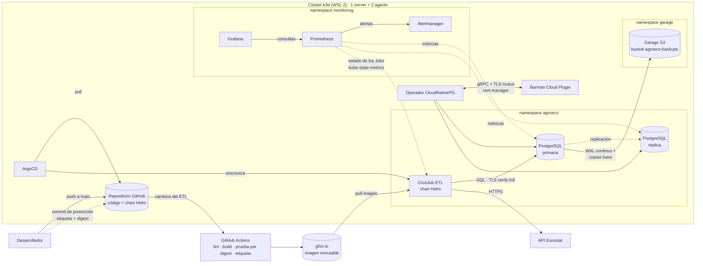

# Agroeco-EU K8s Platform

Migración del pipeline ETL de agricultura ecológica de la UE
([Agroeco-EU Cloud Pipeline](https://github.com/SamAnaya11/Agroeco-EU_Cloud-Pipeline),
serverless en Azure) a una plataforma Kubernetes con PostgreSQL gestionado
por operador, empaquetado con Helm, despliegue GitOps y CI/CD.

> Estado: en construcción (Fases 0-5 completadas: GitOps con ArgoCD, CI/CD con GitHub Actions y observabilidad con Prometheus, Alertmanager y Grafana; siguiente: cierre del proyecto con el Experimento G, limpieza).

## Qué hace

Cada mes, un CronJob de Kubernetes ejecuta el ETL:

1. **Extracción**: descarga cuatro tablas de la API pública de Eurostat
   (superficie ecológica por cultivo, % de SAU ecológica, operadores y ganadería).
2. **Transformación**: limpieza con pandas y modelo en estrella (2 dimensiones y 4 hechos).
3. **Carga**: PostgreSQL de alta disponibilidad (primaria y réplica) gestionado por CloudNativePG.

La base de datos archiva su WAL de forma continua en un almacenamiento S3
(Garage) con el Barman Cloud Plugin. La restauración en un clúster nuevo está
probada y devuelve los mismos datos.

## Arquitectura



## Stack

_(Se completará con las versiones exactas verificadas en cada fase.)_

| Componente | Herramienta | Versión |
|------------|-------------|---------|
| Entorno | Ubuntu 26.04.1 LTS sobre WSL 2 | — |
| Contenedores | Docker Engine (WSL 2) | 29.10.0 |
| Kubernetes local | k3d / k3s | 5.9.0 / v1.37.2+k3s1 |
| Cliente Kubernetes | kubectl | v1.37.2 |
| Paquetes | Helm | v4.3.2 |
| Despliegue del ETL | Chart propio [`charts/agroeco-etl`](charts/agroeco-etl) | Chart 0.3.0 (con la alerta `AgroecoEtlJobFallido`); ETL 0.2.1 en prod (`ghcr.io/samanaya11/agroeco-etl:0.2.1`, fijado por digest) |
| Operador de base de datos | CloudNativePG (chart `cloudnative-pg`) | 1.30.2 (chart 0.29.2) |
| Base de datos | PostgreSQL (`ghcr.io/cloudnative-pg/postgresql:18.7-minimal-trixie`) | 18.7 |
| CLI de base de datos | Plugin `kubectl cnpg` | 1.30.2 |
| Certificados (requisito del plugin de backup) | cert-manager (chart OCI `quay.io/jetstack/charts/cert-manager`) | v1.21.3 |
| Backup de PostgreSQL | Barman Cloud Plugin (chart `plugin-barman-cloud`) | v0.16.0 (chart 0.9.0) |
| Almacenamiento S3 para backups | Garage (`dxflrs/garage`), un solo nodo | v2.5.0 |
| GitOps | Argo CD (chart oficial `argo-cd`) | v3.6.3 (chart 10.19.1) |
| CI/CD | GitHub Actions ([`.github/workflows/ci.yaml`](.github/workflows/ci.yaml)) + ghcr.io | Actions fijadas por SHA: `checkout` v7.0.1, `setup-buildx-action` v4.4.1, `login-action` v4.8.0, `metadata-action` v6.2.0, `build-push-action` v7.4.0, `setup-helm` v5.1.0 (Helm v4.3.2) |
| Observabilidad | kube-prometheus-stack (chart `prometheus-community/kube-prometheus-stack`) | 93.11.1: Prometheus v3.16.0, Alertmanager v0.35.1, Grafana 13.3.2, kube-state-metrics 2.20.0, Prometheus Operator v0.95.2 |
| CLI de GitHub | `gh` (repositorio APT oficial, clave `7F38BBB5…62313325` verificada) | 2.105.0 |

## Decisiones técnicas

- **Kubernetes 1.37 con CloudNativePG 1.30.** Según la
  [tabla de versiones de CloudNativePG](https://cloudnative-pg.io/documentation/current/supported_releases/),
  la serie 1.30 da soporte oficial a Kubernetes 1.34, 1.35 y 1.36. La 1.37
  figura como *«tested, but not supported»*: los mantenedores la prueban, pero
  no la cubren formalmente. Para este entorno de demostración se mantiene
  k3s v1.37.2, alineado con la versión estable actual de Kubernetes y de
  kubectl. **En producción se usaría una versión de Kubernetes con soporte
  oficial del operador.**
- **Kubernetes 1.37 con cert-manager 1.21.** El Barman Cloud Plugin necesita
  cert-manager para el TLS mutuo entre el operador y el plugin. Según la
  [tabla de versiones de cert-manager](https://cert-manager.io/docs/releases/),
  la serie 1.21 (última publicada, v1.21.3) da soporte oficial a Kubernetes
  de la 1.33 a la 1.36. La 1.37 todavía no figura en la tabla de ninguna
  versión publicada; la 1.22 está anunciada para noviembre de 2026. Se acepta
  como limitación del entorno de demostración, igual que con CloudNativePG
  1.30, y se actualizará a la 1.22 cuando se publique. **En producción se
  usaría una combinación con soporte oficial.**
- **Imagen `minimal` de PostgreSQL.** CloudNativePG 1.30.2 usa por defecto la
  imagen `system`. Esas imágenes están marcadas como obsoletas, porque incluyen
  Barman para el método `barmanObjectStore`, también obsoleto. Se fija la
  imagen `minimal`: es la más ligera y la recomendada para usar con
  plugins de backup como el Barman Cloud Plugin.
- **PostgreSQL 18, no 19.** CloudNativePG 1.30 admite PostgreSQL de la 15 a la 18.
- **Clúster PostgreSQL de 2 instancias en nodos distintos**
  ([`k8s/04-postgres-cluster.yaml`](k8s/04-postgres-cluster.yaml)): una
  primaria y una réplica en *streaming replication*, con antiafinidad
  obligatoria por nodo. La base de datos y su propietario se crean con el
  mismo Secret `basic-auth` que usa el ETL. El superusuario no tiene acceso
  por red. Este diseño local tiene dos limitaciones aceptadas:
  1. **Volumen atado a su nodo.** Con `local-path` el disco está en el nodo
     de la instancia: un pod borrado se recrea en el mismo nodo, pero si el
     nodo desapareciera esa instancia no podría moverse. En AKS se usaría un
     disco gestionado de Azure, que puede moverse entre nodos de la misma zona.
  2. **Memoria solicitada inferior al límite** (256 Mi frente a 512 Mi). En
     producción, CloudNativePG recomienda que sean iguales, para que
     Kubernetes no expulse a PostgreSQL cuando el nodo va justo de memoria.
     Aquí se reserva menos para ahorrar memoria en WSL.
- **Backup con el Barman Cloud Plugin y un recurso `ObjectStore`**
  ([`k8s/06-objectstore.yaml`](k8s/06-objectstore.yaml)). Se usa en lugar del
  bloque `barmanObjectStore` del Cluster, que está obsoleto. El destino es un
  recurso propio, que el Cluster solo referencia por su nombre
  (`spec.plugins`). La primaria archiva cada WAL en cuanto se completa, y las
  copias base se piden con recursos `Backup`. Juntos permiten restaurar hasta
  el final de una copia o hasta cualquier instante posterior. Retención de 7
  días y compresión gzip.
- **Garage de un solo nodo dentro del clúster**
  ([`k8s/05-garage.yaml`](k8s/05-garage.yaml)), como almacenamiento S3 en
  lugar de MinIO, que está archivado. Garage no publica un chart oficial, así
  que se despliega con manifiestos propios: un StatefulSet, porque el nodo
  guarda su identidad y su layout en el volumen, y un Service solo con la API
  S3. La API de administración no se activa, porque el CLI usa el canal RPC.
  El `rpc_secret` y la clave S3 se crean con `kubectl create secret`, y la
  clave pasa de `garage key create` al Secret sin mostrarse en pantalla.
  Este diseño local tiene tres limitaciones aceptadas:
  1. **Un solo nodo, en el mismo clúster que los datos.** Los objetos no
     tienen copias y el backup comparte destino con el clúster k3d. En un
     entorno real, el bucket estaría fuera del clúster, por ejemplo en Azure
     Blob Storage o en otro centro de datos.
  2. **HTTP sin TLS hacia Garage.** El tráfico no sale del clúster. En
     producción, la conexión con el almacenamiento iría por HTTPS.
  3. **Tamaño del volumen no garantizado.** `local-path` crea el volumen como
     una carpeta del nodo y no aplica el tamaño del PVC (2 Gi) como límite.
     Garage ve todo el disco virtual de WSL, y la capacidad de su layout
     (1 GB) es un peso para repartir los datos, no una cuota.
- **`primaryUpdateMethod: switchover`.** Cuando hay que recrear la primaria,
  el operador promueve antes la réplica ya actualizada en lugar de reiniciar
  la primaria en el sitio, que es el valor por defecto. Hay una excepción:
  al activar por primera vez el archivado de WAL con el plugin, la primaria
  se recrea en el sitio, porque sin el sidecar no podría completar el
  switchover ([TS-03](docs/TROUBLESHOOTING.md#ts-03--no-hay-switchover-al-activar-el-barman-cloud-plugin-pese-a-primaryupdatemethod-switchover)).
- **Chart de Helm solo para el ETL** ([`charts/agroeco-etl`](charts/agroeco-etl)).
  El chart contiene el ConfigMap, el CronJob y el Job de carga inicial. El
  Cluster de CloudNativePG, el ObjectStore, Garage, los namespaces y los
  Secrets quedan fuera, porque tienen otro ciclo de vida: un
  `helm uninstall` del ETL nunca puede borrar la base de datos, su backup ni
  sus credenciales. El chart solo recibe los nombres de los Secrets.
- **Una sola plantilla para el Job y el CronJob.** El pod (seguridad,
  recursos, variables y volúmenes) se define una vez en
  `templates/_helpers.tpl` y lo incluyen los dos objetos. La seguridad del
  pod no es configurable por valores: ningún entorno puede relajarla. El
  esquema `values.schema.json` rechaza valores mal escritos, una etiqueta
  `latest` y los modos TLS que no cifran o no lo exigen.
- **Carga inicial como hook `post-install`.** El `spec.template` de un Job no
  se puede modificar, así que un Job normal haría fallar `helm upgrade` en
  cuanto cambiara la plantilla. Como hook, se ejecuta una vez al instalar y
  Helm espera a que termine. Las ejecuciones posteriores se lanzan desde el
  CronJob (`kubectl create job --from=cronjob/…`), con la misma plantilla.
  Helm no borra los hooks al desinstalar: lo hace su TTL. Con ArgoCD la
  carga inicial está desactivada (ver más abajo).
- **TLS con `verify-full` hacia PostgreSQL.** El pod monta solo la clave
  `ca.crt` del Secret `agroeco-pg-ca` que genera CloudNativePG, nunca
  `ca.key`, como carpeta y sin `subPath`, para que la renovación de la CA
  llegue al pod. `PGSSLROOTCERT` apunta a ella. Con `require` solo se monta la
  CA si se pide verificación: en libpq, una CA configurada convierte
  `require` en `verify-ca`.
- **Raw y processed en un volumen `emptyDir`.** Sustituyen a Blob Storage con
  la misma estructura por fecha. El destino persistente de los datos es
  PostgreSQL.
- **Repositorio y paquete públicos.** ArgoCD lee Git sin credenciales, y el
  clúster descarga la imagen de ghcr.io sin `imagePullSecret`: no hay ningún
  token guardado en el clúster. En el repositorio están activados *secret
  scanning* y *push protection*, además de gitleaks antes de cada push.
- **ArgoCD mínimo** ([`argocd/values-argocd.yaml`](argocd/values-argocd.yaml)).
  Usa el chart oficial con la versión fijada, cuya appVersion ya trae
  Argo CD v3.6.3, sin sustituir la imagen. No lleva Dex (no hay inicio de
  sesión externo) ni notificaciones, y el controlador de ApplicationSet
  queda a 0 réplicas, porque el chart no permite desactivarlo. Todos los
  componentes tienen un límite de memoria, para que nunca puedan quitársela
  a PostgreSQL. El acceso es por `kubectl port-forward`, con el TLS propio
  del servidor. El namespace `argocd` exige Pod Security `restricted`. Antes
  de exigirlo se instaló solo con avisos y con una comprobación
  `--dry-run=server`, y ninguna de las dos dio avisos.
- **AppProject propio en lugar de `default`**
  ([`argocd/01-proyecto-agroeco.yaml`](argocd/01-proyecto-agroeco.yaml)). El
  proyecto `agroeco` solo admite este repositorio, el namespace `agroeco` y
  dos tipos de objeto: ConfigMap y CronJob. No admite objetos de clúster, ni
  `Secret` (las credenciales nunca vienen de Git), ni `Job`.
- **Carga inicial desactivada en ArgoCD**
  ([`argocd/02-app-agroeco-etl.yaml`](argocd/02-app-agroeco-etl.yaml)).
  ArgoCD no distingue entre instalar y actualizar: cada operación es una
  sincronización, y traduce el hook `post-install` a `PostSync`. La carga
  inicial se ejecutaría en cada sincronización, y con `selfHeal` cada
  corrección de drift relanzaría la descarga de Eurostat y la recarga
  completa. Por eso la Application fija `cargaInicial.enabled: false` en
  `valuesObject`, en Git y por encima de `values-prod.yaml`, que no cambia:
  un `helm install` sigue lanzando la carga inicial. Como el proyecto no
  admite `Job`, reactivarla en la Application haría fallar la
  sincronización en lugar de recargar en cada una. En un clúster nuevo, la
  primera carga es una acción puntual
  (`kubectl create job --from=cronjob/agroeco-etl-mensual …`), no un estado
  deseado.
- **Sincronización automática con `prune` y `selfHeal`, sin borrado en
  cascada.**
  - `prune`: lo que desaparece de Git desaparece del clúster.
  - `selfHeal`: los cambios manuales se revierten al estado de Git.
  - La Application no lleva el finalizer
    `resources-finalizer.argocd.argoproj.io`: borrarla deja el ConfigMap y
    el CronJob en el clúster. Es el mismo criterio que con Helm: quitar la
    herramienta de despliegue no debe tirar el ETL.

## Requisitos

- Windows 11 con WSL 2 (Ubuntu) y systemd activado.
- Docker Engine, k3d, kubectl y Helm instalados **dentro de WSL**.
- Recursos asignados a WSL: ver `.wslconfig` en [Reproducción](#reproducción).

## Reproducción

_(Pendiente.)_

## Validación de la carga

El mismo ETL se validó en dos entornos: primero con `docker run` contra un
PostgreSQL 18.7 local, con el sistema de archivos raíz en solo lectura como
en Kubernetes, y después como Job en el clúster contra CloudNativePG, a través
del Service `agroeco-pg-rw`.

| Tabla | Docker local | Kubernetes (primaria) |
|-------|-------------:|----------------------:|
| `dim_pais` | 28 | 28 |
| `dim_cultivo` | 17 | 17 |
| `fact_superficie` | 13 529 | 13 529 |
| `fact_pct_sau` | 620 | 620 |
| `fact_operadores` | 2 015 | 2 015 |
| `fact_ganaderia` | 1 395 | 1 395 |

- **Vista `v_superficie_total`:** superficie ecológica de España de
  2 944 904 ha en 2024, 2 991 881 ha en 2023 y 2 675 331 ha en 2022.
- **Duración del Job:** 13 s, de la descarga de Eurostat a la carga confirmada.
- **Réplica:** la consulta en `agroeco-pg-2` devuelve los mismos 13 529 registros
  de `fact_superficie` con `pg_is_in_recovery() = true`. Los datos se replican
  y la réplica es de solo lectura.
- **Conexión cifrada:** con `PGSSLMODE=require` y `log_connections=on`, el log
  de la primaria registra la conexión del ETL (en la Fase 3 pasa a
  `verify-full`; ver [Despliegue con Helm](#despliegue-con-helm)):

  ```
  connection authorized: user=agroeco database=agroeco application_name=agroeco-etl
  SSL enabled (protocol=TLSv1.3, cipher=TLS_AES_256_GCM_SHA384, bits=256)
  ```
- **Configuración aplicada sin interrupción:** activar `log_connections` en el
  Cluster no reinició ninguna instancia (`RESTARTS 0`). El operador recargó la
  configuración.

Capturas: `13a_consulta_datos.png` (recuentos, vista y réplica) y
`13b_conexion_tls.png` (conexión TLS en el log de PostgreSQL).

> Nota: consultado justo al terminar el log, el Job aún figuraba como
> `Running 0/1` y segundos después pasó a `Complete 1/1`. Desde Kubernetes
> 1.31, el controlador añade la condición final de un Job solo cuando todos
> sus pods han terminado del todo.

## Resultados de los experimentos

| Exp. | Qué demuestra | Resultado |
|------|---------------|-----------|
| A | Autocuración de pods | ✅ El Job sustituye al pod borrado sin intervención y termina `Complete` |
| B | Job/CronJob frente a Deployment | ✅ Como Deployment, el ETL termina bien (código 0) y aun así se reinicia en bucle (`CrashLoopBackOff`) |
| C | Failover de PostgreSQL | ✅ La réplica pasa a primaria 5,7 s después de borrar la primaria; el cliente vuelve a leer los mismos datos sin cambiar su configuración |
| D | Mismo chart, distintos entornos | ✅ Un solo chart y una sola imagen generan dos entornos: prod carga en PostgreSQL con `verify-full` cada mes; dev solo extrae y limpia, con el CronJob suspendido y menos memoria reservada, sin base de datos ni Secrets |
| E | GitOps: corrección de drift y despliegue desde Git | (1) ✅ ArgoCD revierte un cambio manual del CronJob en 2,0 s, con una sincronización parcial automática; los campos que Git no define no se vigilan · (2) ✅ un commit en `values-prod.yaml` lleva a prod la imagen probada por el CI en 2 min 48,7 s, sin `kubectl` ni `helm` contra prod |
| F | Alerta ante fallo del Job | ✅ Un Job fallido dispara `AgroecoEtlJobFallido` en Alertmanager en 1 min 49 s; al borrar el Job, la alerta se resuelve en 26 s |
| G | Limpieza completa | _pendiente_ |

### A · Autocuración

**Procedimiento.** Con el Job `agroeco-etl-manual` en ejecución, se borra su pod
(`kubectl delete pod`) y se observa con `kubectl get pods -w`.

**Resultado.**

- El pod borrado (`…-vv8b9`) pasa a `Terminating` y, en lugar de morir a
  mitad de la ejecución, termina en `Completed`.
- El controlador de Jobs crea por su cuenta un pod nuevo (`…-sn8mv`), que
  recorre `Pending` → `ContainerCreating` → `Running` → `Completed`.
- En los eventos del Job aparecen dos `SuccessfulCreate`, uno por pod, y la
  condición final `Completed`.
- Una segunda ejecución, con marcas de tiempo, confirma el comportamiento:

  | Momento (UTC) | Evento |
  |---------------|--------|
  | 14:17:29 | `Killing`: se borra el pod `…-zblft` |
  | 14:17:38 | `SuccessfulCreate`: el Job crea el pod `…-n8qb7` (**9 s después**) |
  | 14:17:47 | El Job queda `Completed` |

  Estado final del Job: `podReplacementPolicy: TerminatingOrFailed`,
  `succeeded: 1`, `failed: 1`.

Capturas: `08a_exp_A_autocuracion.png` (secuencia) y `08b_exp_A_autocuracion.png`
(eventos), de la primera ejecución; `08c_exp_A_tiempos.png` (eventos con hora y
política de reemplazo), de la segunda.

**Por qué el pod borrado llegó a terminar.** Al borrar un pod, Kubernetes envía
`SIGTERM` al proceso principal del contenedor y, si no ha salido al cabo del
periodo de gracia (`terminationGracePeriodSeconds`, 30 s por defecto), lo
mata con `SIGKILL`. En el contenedor del ETL, `python main.py` es el **PID 1**.
El kernel de Linux no aplica la acción por defecto de una señal (terminar) al
PID 1 de un espacio de nombres si el proceso no ha instalado un manejador, y
Python no instala ninguno para `SIGTERM`. Por eso la señal se ignoró y al ETL
le dio tiempo a acabar dentro de los 30 s de gracia. Si la ejecución hubiera
necesitado más tiempo, `SIGKILL` lo habría cortado. La integridad de los datos
estaría igualmente garantizada, porque toda la carga es una única transacción
y PostgreSQL deshace las transacciones que no llegan a confirmarse.

**Por qué el pod nuevo tarda unos 10 s.** La política por defecto
`podReplacementPolicy: TerminatingOrFailed` permite crear el reemplazo en cuanto
el pod borrado tiene `deletionTimestamp`, sin esperar a que termine. El retraso
no viene de esa política, sino del **retraso exponencial de reintentos** del Job:

1. Sin `podFailurePolicy`, el controlador cuenta un pod en borrado como
   **fallido en el mismo momento**, aunque después termine en `Succeeded`. Por
   eso el Job acaba con `failed: 1`, y ese intento consume uno de los
   reintentos de `backoffLimit`.
2. Tras un fallo, el controlador espera antes de crear el siguiente pod:
   10 s después del primer fallo, y el doble en cada fallo siguiente
   (20 s, 40 s…), hasta un máximo de 10 minutos.
3. Ese retraso se aplica a cualquier pod que falte, también a los de
   `TerminatingOrFailed`. El cálculo parte del momento en que se pidió el
   borrado, y eso cuadra con los ~9-10 s medidos.

Verificado en la [documentación de Jobs](https://kubernetes.io/docs/concepts/workloads/controllers/job/)
y en el código del controlador de la versión del clúster
([`pkg/controller/job/job_controller.go`, v1.37.2](https://github.com/kubernetes/kubernetes/blob/v1.37.2/pkg/controller/job/job_controller.go)):

```go
DefaultJobPodFailureBackOff = 10 * time.Second
// isPodFailed: "Count deleted Pods as failures to account for orphan Pods that
// never have a chance to reach the Failed phase."
return p.DeletionTimestamp != nil && p.Status.Phase != v1.PodSucceeded
// manageJob, antes de crear pods:
remainingTime = jobCtx.newBackoffRecord.getRemainingTime(jm.clock, DefaultJobPodFailureBackOff, MaxJobPodFailureBackOff)
```

### B · Job frente a Deployment

**Procedimiento.** Se despliega el mismo contenedor, con la misma
configuración y seguridad, como Deployment de 1 réplica
([`k8s/experimentos/b-etl-como-deployment.yaml`](k8s/experimentos/b-etl-como-deployment.yaml))
y se observa durante 33 minutos.

**Resultado.**

| Observación | Valor |
|-------------|-------|
| Última salida del contenedor | código `0` (`Completed`): el ETL termina **correctamente** |
| Estado del pod | `CrashLoopBackOff`, 8 reinicios en 33 min, con esperas crecientes entre reinicios |
| Eventos `BackOff` | 20 × `Back-off restarting failed container etl…` |
| Estado del Deployment | `READY 0/1`, `AVAILABLE 0` |
| Condiciones del Deployment | `Progressing=True (NewReplicaSetAvailable)`, `Available=False (MinimumReplicasUnavailable)` |
| Descargas de Eurostat | 4 por ejecución → unas 36 en total, y sigue creciendo |
| Job con el mismo contenedor | `Complete 1/1`: una ejecución, 4 descargas, sin reinicios |

Las dos condiciones resumen el problema. El despliegue en sí es correcto: el
ReplicaSet se creó (`Progressing=True`). Pero la aplicación nunca llega a
estar disponible (`Available=False`), porque el proceso termina cada vez.
Al borrar el Deployment desaparecen su ReplicaSet y su pod, y en el namespace
solo quedan los pods `Completed` de los Jobs.

Captura: `09_exp_B_job_vs_deployment.png`.

**Por qué.** Un Deployment mantiene N réplicas **siempre** en marcha y solo
admite `restartPolicy: Always`. Para él, que el proceso termine es un fallo,
sea cual sea su código de salida. Por eso el evento habla de *failed container*
aunque el ETL saliera con 0. El kubelet lo reinicia con esperas que se duplican
(10 s, 20 s, 40 s…, hasta 5 min), y el Deployment nunca llega a tener la
réplica disponible que se le pide.

| | Job / CronJob | Deployment |
|---|---|---|
| Pensado para | Trabajo que termina | Servicio que no debe terminar |
| Salida con código 0 | `Complete`: no hace nada más | Reinicio → `CrashLoopBackOff` |
| Salida con código ≠ 0 | Reintenta hasta `backoffLimit` y queda `Failed` (se puede alertar) | Reinicio sin fin |
| Efecto sobre Eurostat y PostgreSQL | Una descarga y una carga por ejecución | Descargas y, con la carga activa, recargas completas en bucle |
| Programación | El CronJob decide cuándo | Sin noción de horario |
| Estado visible | Distingue con claridad éxito y fallo | `CrashLoopBackOff` tanto si el ETL fue bien como si fue mal |

### C · Failover de PostgreSQL

**Procedimiento.** Un pod cliente
([`k8s/experimentos/c-cliente-psql.yaml`](k8s/experimentos/c-cliente-psql.yaml))
abre cada 2 s una conexión nueva al Service `agroeco-pg-rw`, el mismo que
usa el ETL, con un tiempo máximo de conexión de 3 s. En cada vuelta registra
la IP del servidor que responde, si es primaria o réplica, y las filas de
`fact_superficie`. Con el cliente en marcha se borra el pod primario
(`kubectl delete pod agroeco-pg-1`).

**Situación inicial.** Primaria `agroeco-pg-1` (`10.42.0.16`, nodo `server-0`)
y réplica `agroeco-pg-2` (`10.42.1.6`, nodo `agent-1`).

**Cronología** (UTC). Las horas del borrado y del cliente son las de la
terminal. Las del failover salen de los eventos del Cluster y de
`.status.currentPrimaryTimestamp`.

| Hora | Δ | Qué ocurre | Fuente |
|------|---|------------|--------|
| 19:31:11 | — | Última respuesta de la primaria original: `10.42.0.16 primaria 13529` | cliente |
| 19:31:12 | 0 s | `kubectl delete pod agroeco-pg-1` | terminal |
| 19:31:13 | +1 s | Evento `FailingOver`: el operador detecta la caída de la primaria | eventos |
| 19:31:13 | +1 s | Cliente: `FATAL: the database system is shutting down` | cliente |
| 19:31:14 | +2 s | Evento `FailoverTarget`: el operador elige `agroeco-pg-2` | eventos |
| 19:31:15 | +3 s | Cliente: intento que acaba en `timeout expired` (3 s) | cliente |
| **19:31:17,73** | **+5,7 s** | **`agroeco-pg-2` ascendida a primaria** | `currentPrimaryTimestamp` |
| 19:31:20 | +8 s | Cliente: `10.42.1.6 primaria 13529`, y así cada 2 s, sin más errores | cliente |

**Resultado.**

- **Tiempo sin primaria: 5,7 s.** El cliente lo percibe como 8 s porque
  consulta a intervalos. El intento de las 19:31:15 empezó antes del ascenso
  y agotó su tiempo de conexión, y el siguiente llegó tras la pausa de 2 s.
  Con una aplicación que reintente más a menudo, el corte visible se
  acercaría a los 5,7 s.
- **Sin cambios en el cliente.** El Service `agroeco-pg-rw` mantiene la misma
  IP (`10.43.119.74`). El operador lo redirige a la nueva primaria, y el
  cliente, igual que el ETL, sigue usando el mismo nombre.
- **Sin pérdida de datos visible:** antes y después se leen las mismas
  13 529 filas.
- **Reincorporación automática.** Kubernetes vuelve a crear `agroeco-pg-1`
  en su nodo, donde está su volumen `local-path`. El operador lo reincorpora
  **como réplica** de la nueva primaria, en *streaming*, con el clúster en
  `Cluster in healthy state` y 2/2 instancias. La primaria se queda en
  `agroeco-pg-2`. CloudNativePG no deshace el failover, y si interesara se
  haría con un cambio controlado de primaria (`kubectl cnpg promote`).

**Escritura en la nueva primaria.** Con el cliente todavía leyendo, se
relanza el Job del ETL sin tocar su configuración:

- El Job termina `Complete 1/1` en 15 s. Se conecta a
  `agroeco-pg-rw` a las 20:14:21, sin reintentos, y entre las 20:14:21 y las
  20:14:24 borra, crea y recarga las 6 tablas (28, 17, 13 529, 620, 2 015 y
  1 395 filas).
- El log de `agroeco-pg-2`, la antigua réplica, registra la conexión del ETL
  a las 20:14:21,794 con `SSL enabled (protocol=TLSv1.3,
  cipher=TLS_AES_256_GCM_SHA384, bits=256)`. Es la nueva primaria la que
  recibe las escrituras, cifradas. Una línea anterior, de las 20:05:44, es
  de un primer lanzamiento repetido.
- **El cliente no ve nunca un estado intermedio.** Todas sus lecturas
  devuelven `10.42.1.6 primaria 13529`, sin errores ni recuentos parciales.
  El único intervalo mayor de lo normal va de las 20:14:22 a las 20:14:26.
  La hora de cada línea es la del inicio de la consulta, así que la de las
  20:14:22 esperó unos 2 s al bloqueo exclusivo que el ETL mantiene sobre la
  tabla, y respondió cuando terminaron las inserciones. Después vinieron los
  2 s de pausa del bucle. Como el ETL hace el `DROP`, el `CREATE` y los
  `INSERT` en **una sola transacción**, los demás clientes ven la tabla
  anterior completa o la nueva completa, nunca una tabla vacía o a medias.

**Balance del log del cliente.** El log completo tiene 3 199 lecturas, de
19:23:54 a 21:27:42 UTC, y solo **2 errores**: los dos del failover
(`the database system is shutting down` a las 19:31:13 y `timeout expired` a
las 19:31:15). Solo hay tres intervalos de más de 3 s entre lecturas:

| Intervalo | Duración | Causa |
|-----------|----------|-------|
| 19:31:15 → 19:31:20 | 5 s | Failover |
| 20:14:22 → 20:14:26 | 4 s | Espera al bloqueo durante la carga del ETL |
| 20:55:47 → 21:08:57 | 790 s | Suspensión del equipo |

> **Nota.** El hueco de 790 s no forma parte del failover. El PC entró en
> suspensión y con él se pausaron WSL y el clúster k3d. No hay ningún error
> antes ni después del hueco, y al volver el cliente siguió leyendo
> `10.42.1.6 primaria 13529`. Los nodos conservan su antigüedad, así que
> ninguno se reinició.

**Estado final.** Tras borrar el cliente, el clúster sigue en
`Cluster in healthy state`, con 2/2 instancias y `agroeco-pg-2` como
primaria. Las dos instancias están en `1/1 Running` con 0 reinicios y los
3 nodos están `Ready`. Los eventos del Job registran sus dos ejecuciones
completas: de 20:05:32 a 20:05:50 y de 20:14:12 a 20:14:27.

Capturas: `14a_exp_C_log_cliente.png` (log del cliente: corte y cambio de IP),
`14b_exp_C_cnpg_status.png` (estado tras el failover) y
`14c_exp_C_job_nueva_primaria.png` (Job relanzado contra la nueva primaria).

### D · Mismo chart, distintos entornos

**Procedimiento.** El chart `charts/agroeco-etl` se despliega con dos
archivos de valores:
- `values-prod.yaml`: la release del namespace `agroeco`, revisión 2 (ver
  [Despliegue con Helm](#despliegue-con-helm)).
- `values-dev.yaml`: una segunda release con el mismo nombre en el namespace
  `agroeco-dev` ([`k8s/00b-namespace-dev.yaml`](k8s/00b-namespace-dev.yaml)),
  con las mismas etiquetas de Pod Security `restricted`. En Helm el nombre de
  una release es único por namespace, así que las dos conviven.

Para no duplicar PostgreSQL en la memoria de WSL, dev no tiene base de datos:
el ETL solo extrae y limpia. Las dos ejecuciones nunca coinciden en el
tiempo. Al terminar, la release de dev se desinstala y se borra su namespace.

**1. Diferencias en los objetos generados**
(`diff -u` entre `helm template` con cada archivo de valores):

| Objeto | dev | prod |
|--------|-----|------|
| ConfigMap | `ETL_CARGAR_BD=false`, `ETL_NIVEL_LOG=DEBUG`; 3 claves, ninguna de PostgreSQL | `ETL_CARGAR_BD=true`, `ETL_NIVEL_LOG=INFO`; 8 claves, con `PGHOST`, `PGSSLMODE=verify-full` y `PGSSLROOTCERT` |
| CronJob | `0 7 * * 1`, `suspend: true`, historial 1/1 | `0 6 1 * *`, `suspend: false`, historial 3/3 |
| Pod | Sin credenciales ni CA; requests `100m` / `256Mi` | `PGUSER`/`PGPASSWORD` desde `agroeco-db-app`, CA `pg-ca` montada; requests `250m` / `512Mi` |
| Job de carga inicial | TTL 3 600 s | TTL 86 400 s |

No cambian los nombres, las etiquetas, la imagen `agroeco-etl:0.1.0`, la
seguridad del pod y del contenedor, los `emptyDir` ni el límite de memoria
de 1 Gi. El límite se mantiene a propósito: pandas procesa los mismos datos
en los dos entornos.

**2. Release de dev en el clúster.**
- `helm list -A`: `agroeco-etl` en `agroeco` (revisión 2) y en `agroeco-dev`
  (revisión 1), las dos `deployed` con `agroeco-etl-0.1.0`.
- Carga inicial de dev `Complete` en 11 s; el pod pasó a `Completed` en 8 s,
  frente a 15 s en prod, que además carga las 6 tablas. El log termina con
  `>>> 3. Carga en PostgreSQL omitida (ETL_CARGAR_BD=false)` y
  `Pipeline terminado correctamente`, sin ninguna conexión a PostgreSQL.
- CronJob de dev con `SUSPEND True`: solo se ejecuta a mano.

**3. Limpieza.** Después de `helm uninstall` en `agroeco-dev` quedaban solo
el Job `agroeco-etl-carga-inicial` (`Complete 1/1`) y el ConfigMap
`kube-root-ca.crt`, que Kubernetes crea en cada namespace. Se confirma así
que Helm no borra los hooks al desinstalar. El Job desapareció al borrar el
namespace, sin esperar a su TTL. La release de prod (revisión 2) y
`agroeco-pg` siguieron intactos.

**Nivel de log.** El nivel está configurado por entorno, pero **hoy no tiene
efecto visible**. El ETL lee `ETL_NIVEL_LOG` y lo aplica, pero su código no
emite mensajes DEBUG: el log de dev tiene 35 líneas, todas `INFO`
([TS-06](docs/TROUBLESHOOTING.md#ts-06--el-nivel-debug-de-dev-no-muestra-nada-más-que-prod)).
Los mensajes DEBUG llegarán en la Fase 4, con la imagen que construya
GitHub Actions.

**Conclusión.** Las diferencias entre entornos están solo en dos archivos de
valores revisables en Git, y el resto del despliegue es idéntico por
construcción. Promover un cambio de dev a prod es aplicar el mismo chart con
otro archivo, no mantener dos copias de los manifiestos.

Capturas: `19a1_exp_D_diff_configmap.png` y `19a2_exp_D_diff_cronjob.png`
(diff entre los entornos) y `19b_exp_D_release_dev.png` (las dos releases y
la ejecución de dev).

### E · GitOps: corrección de drift y despliegue desde Git

#### E (1) · Corrección automática del drift

**Procedimiento.** Con la Application `agroeco-etl` en `Synced`/`Healthy`
(commit `1f9a403`) se hacen dos cambios a mano en el CronJob que gestiona
ArgoCD:
- **Cambio en un campo declarado en Git.** Se suspende el CronJob, como si
  alguien parara el ETL de prod:
  `kubectl patch cronjob agroeco-etl-mensual --type merge -p '{"spec":{"suspend":true}}'`.
  Una terminal vigila el CronJob con la hora de cada cambio, y otra lanza
  el cambio.
- **Cambio fuera de lo declarado.** Se añade una etiqueta que el chart no
  define (`experimento=drift-etiqueta`).

**Cronología del primer cambio** (UTC, 25-11-2026):

| Hora | Δ | Qué ocurre | Fuente |
|------|---|------------|--------|
| 16:22:48,866 | 0 s | Se lanza `kubectl patch` | terminal |
| 16:22:49,205 | +0,3 s | CronJob con `suspend: true`, `generation` 3 | vigilancia |
| 16:22:49 | — | ArgoCD detecta el cambio: `Synced -> OutOfSync`, e inicia la sincronización automática a `1f9a403` | eventos |
| **16:22:50,902** | **+2,0 s** | **CronJob de nuevo con `suspend: false`, `generation` 4** | vigilancia |
| 16:22:50 | — | `Partial sync operation … succeeded` y `OutOfSync -> Synced` | eventos |

**Resultado.**
- **Corrección en 2,0 s desde el comando**, y 1,7 s desde que el cambio
  quedó aplicado. En los 30 s siguientes no hubo ningún cambio más: ni
  bucle ni lucha entre el cambio manual y ArgoCD.
- **La lanzó ArgoCD, no una persona.** La operación figura como
  `initiatedBy: {"automated":true}`, de 16:22:49Z a 16:22:50Z, `Succeeded`.
  No hace falta esperar al ciclo de reconciliación de 2-3 min: ArgoCD vigila
  los objetos que gestiona y detecta el cambio al momento.
- **Solo se tocó lo desviado.** `selfHeal` lanzó una sincronización
  parcial. El resultado solo incluye
  `cronjob.batch/agroeco-etl-mensual configured`, y el ConfigMap ni
  aparece.
- **Sin el aviso de `last-applied-configuration`.** Se confirma que el aviso
  de la primera sincronización era de un solo uso
  ([TS-07](docs/TROUBLESHOOTING.md#ts-07--aviso-de-last-applied-configuration-en-la-primera-sincronización-de-argocd)).
- **La `generation` deja rastro.** Pasa de 2 a 3 (cambio manual) y a 4
  (corrección): el `spec` cambió dos veces y volvió a ser el de Git.

**Alcance de `selfHeal`.** Tres minutos después de añadir la etiqueta
`experimento=drift-etiqueta`, el intervalo máximo de reconciliación, la
Application seguía `Synced` y la etiqueta seguía puesta. Con la comparación
por defecto, ArgoCD solo vigila los campos que define Git: un campo añadido
que el chart no menciona no cuenta como diferencia. `selfHeal` protege lo
declarado, pero no impide añadir cosas. Lo que deba estar prohibido se
declara en Git o se impide con permisos (RBAC) o con políticas de admisión.

**Limpieza.** La etiqueta se quitó a mano al terminar
(`kubectl label cronjob agroeco-etl-mensual -n agroeco experimento-`). El CronJob quedó
con `suspend: false` y `generation` 4, y la Application en
`Synced`/`Healthy`.

Captura: `21_exp_E_drift.png` (vigilancia con `false 2` → `true 3` →
`false 4` y la operación automática de ArgoCD).

#### E (2) · Promoción a prod por GitOps

**Objetivo.** Comprobar que una imagen llega a prod solo con un commit en
Git, sin `kubectl` ni `helm` contra el clúster, y que lo que se despliega es,
bit a bit, lo que probó el CI.

**Procedimiento.**
- El bloque `image:` se copia tal cual del apartado «Promoción a prod» del
  resumen de la ejecución del CI que probó la imagen (ejecución
  `45667174486`, commit `fb222f7`): repositorio
  `ghcr.io/samanaya11/agroeco-etl`, etiqueta `0.2.1` y digest del índice
  `sha256:5c06ff2e…55338`.
- Commit `40b97d8` «Promoción a prod: ETL 0.2.1 por etiqueta y digest», que
  solo cambia [`values-prod.yaml`](charts/agroeco-etl/values-prod.yaml), y
  push a `main`.
- Una terminal vigila el CronJob con la hora de cada cambio (imagen,
  `app.kubernetes.io/version` y `generation`).

**Cronología** (UTC, 25-11-2026):

| Hora | Δ | Qué ocurre | Fuente |
|------|---|------------|--------|
| 21:11:08,947 | — | CronJob con `agroeco-etl:0.1.0`, versión 0.1.0, `generation` 6 | vigilancia |
| 21:13:14,816 | 0 s | `git push` del commit de promoción `40b97d8` | terminal |
| **21:16:03,516** | **+2 min 48,7 s** | **CronJob con `ghcr.io/samanaya11/agroeco-etl:0.2.1@sha256:5c06ff2e…55338`, versión 0.2.1, `generation` 7** | vigilancia |

La Application quedó en `40b97d8`, `Synced`/`Healthy`, con
`initiatedBy: {"automated":true}`. Nadie ejecutó `kubectl` ni `helm` contra
prod para el cambio. La latencia cae dentro del ciclo de consulta de ArgoCD
a Git (unos 3 min). A diferencia del drift del E (1), que ArgoCD detecta al
momento porque vigila los objetos del clúster, un commit nuevo solo se ve
al consultar el repositorio. Un webhook de GitHub la bajaría a segundos (ver
Tareas pendientes).

**Comprobación en prod.** Ejecución manual desde el CronJob:
`kubectl create job --from=cronjob/agroeco-etl-mensual etl-promocion-021`.
- **Job** `Complete`, `1/1`, duración 88 s.
- **`imageID` del pod:**
  `ghcr.io/samanaya11/agroeco-etl@sha256:5c06ff2e…55338`. El nodo descargó
  el digest probado, sin token.
- **Log:** primera línea `agroeco-etl 0.2.1` y
  `Pipeline terminado correctamente`.
- **Filas cargadas en PostgreSQL:**

  | Tabla | Filas |
  |-------|------:|
  | `dim_pais` | 28 |
  | `dim_cultivo` | 17 |
  | `fact_superficie` | 13.529 |
  | `fact_pct_sau` | 620 |
  | `fact_operadores` | 2.015 |
  | `fact_ganaderia` | 1.395 |

  Son las mismas cifras que con la 0.1.0 y que en la prueba local: el
  código nuevo solo añade mensajes y no cambia los datos.
- **0 líneas `DEBUG`**, porque prod usa `nivelLog: INFO`.
- **9 s de ETL frente a 88 s de Job.** El ETL empezó a las 21:26:35 y
  terminó a las 21:26:44. Los unos 79 s restantes fueron la primera
  descarga de la imagen desde ghcr.io al nodo. Las ejecuciones siguientes
  en ese nodo la encuentran ya descargada (`pullPolicy: IfNotPresent`).

**Conclusión.**
- **Lo probado es lo desplegado, bit a bit.** El digest de
  `values-prod.yaml` es el que pasó la prueba de humo en el CI, y es el que
  muestra el `imageID` del pod. Ni la etiqueta ni el registro pueden
  cambiarlo.
- **Trazabilidad en Git.** Qué versión hay en prod, quién la cambió y
  cuándo está en el historial: un commit por promoción.
- **Vuelta atrás con `git revert`** del commit de promoción. ArgoCD aplica
  la versión anterior por el mismo camino.

Capturas: `24a_exp_E_promocion.png` (vigilancia del CronJob: de
`agroeco-etl:0.1.0`, `generation` 6, a `ghcr.io/…:0.2.1@sha256:5c06…`,
`generation` 7, a las 21:16:03,516) y `24b_exp_E_promocion.png` (commit
`40b97d8`, Application `Synced`/`Healthy`, Job `Complete`, `imageID`, log
y 0 líneas `DEBUG`).

### F · Alerta ante el fallo del Job

**Objetivo.** Comprobar que un fallo del ETL llega a Alertmanager sin que
nadie mire el clúster, medir cuánto tarda en dispararse la alerta y en
resolverse, y ver que la alerta dice qué Job falló y cómo leer sus logs.

**Procedimiento.**
- Se aplica [`k8s/experimentos/f-job-fallido.yaml`](k8s/experimentos/f-job-fallido.yaml):
  un Job con la imagen de prod, fijada por digest, y un error de
  configuración realista, `ETL_CARGAR_BD=quizas`. El propio ETL lo detecta
  al arrancar, antes de descargar nada o conectar a PostgreSQL, y sale con
  código 1. Tiene `backoffLimit: 0`, así que no hay reintentos.
- Una terminal consulta cada 5 s tres cosas: los pods fallidos del Job, el
  estado de la regla en la API de Prometheus y las alertas activas en la
  API v2 de Alertmanager.
- Al final se borra el Job y se mide cuánto tarda en resolverse la alerta.

**Estado de partida.** En `agroeco` no había ningún Job fallido: solo
`agroeco-etl-manual-tls` y `etl-promocion-021`, los dos completados. La
regla `AgroecoEtlJobFallido` estaba `inactive`, con salud `ok` (evaluada a
las 16:02:40), y en Alertmanager no había ninguna alerta.

**Cronología** (UTC, 26-11-2026; la vigilancia da una precisión de unos 5 s):

| Hora | Δ | Qué ocurre | Fuente |
|------|---|------------|--------|
| 16:05:26 | 0 s | `kubectl apply -f k8s/experimentos/f-job-fallido.yaml` | terminal |
| 16:05:38 | +12 s | El Job tiene 1 pod fallido | vigilancia (Job) |
| 16:06:10 | +44 s | Regla en `pending` | API de Prometheus |
| **16:07:15** | **+1 min 49 s** | **Regla en `firing` y 1 alerta en Alertmanager** | API de Prometheus y de Alertmanager |
| 16:18:15 | 0 s | `kubectl delete -f k8s/experimentos/f-job-fallido.yaml` | terminal |
| 16:18:36 | +21 s | La regla sigue en `firing` | API de Prometheus |
| **16:18:41** | **+26 s** | **Regla en `inactive` y 0 alertas en Alertmanager** | API de Prometheus y de Alertmanager |

**Qué explica cada tramo.**
- **+12 s, hasta el pod fallido.** Es lo que tardan en crearse el pod y en
  arrancar Python, que importa pandas antes de leer la configuración.
  Después, el ETL falla al momento. El log muestra
  `ValueError: Valor no válido para ETL_CARGAR_BD: 'quizas' (usa true o false)`,
  lanzado desde `variable_booleana` en `pipeline.py`.
- **32 s más, hasta `pending`.** kube-state-metrics ve el pod fallido casi
  al instante, porque vigila la API. Prometheus lo recoge en su siguiente
  lectura (intervalo de 30 s), y la regla lo ve en su siguiente evaluación
  (otros 30 s). El peor caso sería de unos 60 s.
- **65 s en `pending`, hasta `firing`.** Es el `for: 1m` de la regla. Con
  evaluaciones cada 30 s, la condición se cumple en tres evaluaciones
  seguidas, y la tercera la pasa a `firing`. Los 5 s que pasan del minuto
  entran en la precisión de la vigilancia. En la misma evaluación,
  Prometheus envía la alerta a Alertmanager.
- **26 s hasta resolverse.** Para resolverse no hay `for`, porque la regla
  no define `keep_firing_for`. Al borrar el Job desaparece su serie en
  kube-state-metrics. Basta una lectura de Prometheus que ya no la
  encuentre y una evaluación de la regla, como mucho unos 60 s.

**Qué llegó a Alertmanager.**
- **Etiquetas:** `alertname=AgroecoEtlJobFallido`,
  `job_name=etl-experimento-f`, `namespace=agroeco` y `severity=warning`.
- **`summary`:** «El Job etl-experimento-f del ETL ha fallado en el
  namespace agroeco».
- **`description`:** el número de pods fallidos y el comando para leer los
  logs, `kubectl logs -n agroeco job/etl-experimento-f`.

Al terminar, en `agroeco` solo quedaron los dos Jobs buenos.

**Conclusión.**
- **El fallo se detecta sin mirar el clúster.** La alerta llega en menos
  de 2 min, y dice qué Job falló, dónde y cómo investigarlo. Para un ETL
  mensual es más que suficiente, y el `for: 1m` evita avisos por un dato
  suelto.
- **La alerta va con el código.** La regla forma parte del chart y la
  despliega ArgoCD, como el CronJob. Cambiarla es un commit, igual que
  cambiar la imagen.
- **Se resuelve sola en cuanto desaparece la causa**, sin intervención en
  Prometheus ni en Alertmanager.

**Limitación de diseño.** La expresión `kube_job_status_failed > 0` sigue
activa mientras exista el Job fallido. En los Jobs del CronJob eso puede
durar semanas, porque `failedJobsHistoryLimit: 3` los conserva. Borrar el
Job equivale a darlo por revisado. Hay otro caso: con `backoffLimit: 2`, un
Job cuyo reintento termina bien también mantiene la alerta, porque conserva
el pod fallido. Una mejora posible es
`kube_job_status_failed{namespace="agroeco"} > 0 unless on(namespace, job_name) kube_job_status_succeeded > 0`.
Así, un fallo que se recupera en un reintento ya no dejaría la alerta
activa (ver Tareas pendientes).

Capturas: `26a_exp_F_cronologia.png` (T0, la cronología de `inactive` a
`pending` y a `firing` con 1 alerta en Alertmanager, y el `ValueError` del
log) y `26b_exp_F_alertmanager.png` (la alerta en la interfaz de
Alertmanager, con sus etiquetas y sus anotaciones).

## Backup y restauración

Sin un backup externo, la alta disponibilidad no protege frente a borrados
o corrupción lógica, porque la réplica copia también los errores.

**Procedimiento.**
1. Se instalan cert-manager y el Barman Cloud Plugin, y se despliega Garage
   con el bucket `agroeco-backups` y una clave de lectura y escritura sin
   permisos de propietario.
2. Se conecta `agroeco-pg` al plugin (`spec.plugins`), que empieza a
   archivar el WAL de forma continua (`ContinuousArchiving=True`).
3. Se lanza un backup bajo demanda
   ([`k8s/07-backup.yaml`](k8s/07-backup.yaml)), con `method: plugin` y
   `target: prefer-standby`.
4. Se crea un clúster nuevo, `agroeco-pg-restore`
   ([`k8s/08-postgres-restore.yaml`](k8s/08-postgres-restore.yaml)), a partir
   de ese backup. No tiene `spec.plugins`, así que no escribe en el bucket.
5. Se comparan los datos con el original y se borra el clúster restaurado.

El contenido del bucket se lista con un Pod de un solo uso
([`k8s/utilidades/s3-listado.yaml`](k8s/utilidades/s3-listado.yaml)), porque el
CLI de Garage da el número de objetos pero no su lista.

**Backup** (`agroeco-pg-backup-manual`).

| Dato | Valor |
|------|-------|
| Instancia de origen | `agroeco-pg-1` (la réplica, por `prefer-standby`) |
| ID / duración | `20261123T210625`, de 21:06:26 a 21:06:35 UTC (9 s) |
| LSN inicial / final | `0/12000FE0` / `0/14000000` |
| Contenido del bucket | `base/20261123T210625/` (`data.tar.gz` de 4,4 MiB y `backup.info`) y los WAL `…0011`, `…0012` y `…0013` comprimidos con gzip: 5 objetos, 4,4 MiB |

**Restauración** (`agroeco-pg-restore`).

| Comprobación | Resultado |
|--------------|-----------|
| Estado | `Cluster in healthy state`, 1/1, primaria `agroeco-pg-restore-1` |
| Recuentos por tabla | 28, 17, 13 529, 620, 2 015 y 1 395: los mismos que el original |
| Recuperación terminada | `pg_is_in_recovery() = false`, en una línea temporal nueva (3) |
| Punto de recuperación | `00000003.history`: `2  0/14000000  no recovery target specified`. Se reprodujo el WAL hasta el final de la copia |
| Bucket después de la prueba | Los mismos 5 objetos. No aparece ninguna ruta `agroeco-pg-restore/` ni ningún archivo de la línea temporal 3 |

**Observaciones.**
- **El backup termina justo en un límite de segmento.** El LSN final
  `0/14000000` es el primer byte del segmento 0014, así que la copia solo
  necesita el WAL hasta el 0013, que ya estaba archivado. La base no tenía
  actividad, y en ese caso `archive_timeout` no cierra segmentos y
  `pg_switch_wal()` no hace nada. Desde PostgreSQL 17, `pg_walfile_name()`
  asigna un LSN situado en el límite al segmento que empieza en él, de ahí
  que `endWal` sea el 0014.
- **Sidecar temporal en el clúster restaurado.** El Job de recuperación y
  el primer pod de la instancia llevan el sidecar del plugin. Cuando termina
  el arranque, el operador recrea el pod sin él. Es un comportamiento
  previsto del plugin v0.16.0 para los clústeres que solo lo usan para
  recuperarse.
- Al activar el plugin hubo dos efectos documentados en
  [TS-03](docs/TROUBLESHOOTING.md#ts-03--no-hay-switchover-al-activar-el-barman-cloud-plugin-pese-a-primaryupdatemethod-switchover):
  la primaria se recreó sin switchover, y hubo 6 fallos inocuos al archivar
  el WAL 0011. Las otras dos sorpresas de la prueba están en
  [TS-04](docs/TROUBLESHOOTING.md#ts-04--kubectl-apply-responde-configured-sin-haber-cambios)
  (`configured` sin cambios) y
  [TS-05](docs/TROUBLESHOOTING.md#ts-05--falta-00000002history-en-el-archivo-de-wal)
  (historial de líneas temporales incompleto en el archivo).

Capturas: `16a_backup_completado.png` (backup `completed` y listado del
bucket) y `16b_restauracion.png` (clúster restaurado y recuentos).

## Despliegue con Helm

El ETL se despliega con el chart [`charts/agroeco-etl`](charts/agroeco-etl),
que sustituye a los manifiestos `k8s/01-configmap.yaml`, `02-job.yaml` y
`03-cronjob.yaml` de las fases 1 y 2. Esos manifiestos se retiran del
repositorio y siguen en el historial de Git.

**Validación sin tocar el clúster.**
- `helm lint --strict` con los valores por defecto, con `values-dev.yaml` y con
  `values-prod.yaml`: `0 chart(s) failed` en los tres.
- `helm template … | kubectl apply --dry-run=server`: el servidor acepta los
  tres objetos de dev y de prod y no da ningún aviso de Pod Security
  `restricted`.

**Migración desde los manifiestos.** Helm no instala sobre objetos que ya
existen y no pertenecen a ninguna release, así que antes se borraron el
CronJob y el ConfigMap antiguos. El Job `etl-prueba-cron` del Experimento B se
borró en cascada con el CronJob: su `ownerReference` apunta a él con
`controller=true`. `blockOwnerDeletion` está vacío porque
`kubectl create job --from` no lo activa, y solo cuenta en el borrado en
primer plano. PostgreSQL no se tocó.

**Revisiones.**

| Rev. | Cambio | Resultado |
|------|--------|-----------|
| 1 | `helm install` con `values-prod.yaml` y `--set postgres.tls.sslmode=require`: reproduce exactamente el comportamiento de los manifiestos | `deployed`. Carga inicial (hook) `Complete` en 17 s, con las 6 tablas (28, 17, 13 529, 620, 2 015, 1 395). ConfigMap con las mismas 7 claves que el antiguo; sin CA montada |
| 2 | `helm upgrade` solo con `values-prod.yaml`: `verify-full` | `deployed` (la 1 queda `superseded`). ConfigMap con 8 claves: `PGSSLMODE=verify-full` y `PGSSLROOTCERT=/etc/agroeco/pg-ca/ca.crt`. El CronJob monta `pg-ca` con solo `ca.crt` |

Sin `--reuse-values`, `helm upgrade` recalcula los valores desde el chart y
los archivos indicados, así que el `--set` de la revisión 1 no pasa a la 2,
que queda descrita entera por los archivos de Git.

**Verificación de `verify-full`.**
- **Caso positivo.** Ejecución manual desde el CronJob
  (`agroeco-etl-manual-tls`): `Complete` en 12 s, con las 6 tablas cargadas.
  El log de la primaria `agroeco-pg-2` registra a las 17:02:08 UTC
  `connection authorized: user=agroeco database=agroeco application_name=agroeco-etl SSL enabled (protocol=TLSv1.3, cipher=TLS_AES_256_GCM_SHA384, bits=256)`.
  Desde el servidor no se distingue `require` de `verify-full`; la prueba está
  en que el cliente se conectó con la verificación activada.
- **Prueba negativa**
  ([`k8s/experimentos/verify-full-negativa.yaml`](k8s/experimentos/verify-full-negativa.yaml)).
  Un Pod de un solo uso con `psql` y sin credenciales: la verificación TLS va
  antes de la autenticación, así que `fe_sendauth: no password supplied`
  significa «certificado aceptado» y no se lee ningún dato. La IP del Service
  `agroeco-pg-rw` (10.43.119.74) apunta al mismo servidor, pero no está en el
  SAN de su certificado.

| Caso | Host | Modo | Resultado |
|------|------|------|-----------|
| A | `agroeco-pg-rw` | `verify-full` + CA | `fe_sendauth: no password supplied`: certificado aceptado |
| B | `10.43.119.74` | `verify-full` + CA | **Rechazado**: `server certificate for "agroeco-pg-rw" (and 12 other names) does not match host name "10.43.119.74"` |
| C | `10.43.119.74` | `require`, sin CA | `fe_sendauth: no password supplied`: `require` acepta un servidor sin comprobar su nombre |

B y C se conectan al mismo servidor y solo cambia el modo. Es justo la
protección que añade la revisión 2: con `require`, el ETL hablaría con
cualquier servidor que respondiera en esa dirección con un certificado
cualquiera, y le enviaría los datos de la carga.

Capturas: `17a_helm_lint.png` y `17b_helm_template_cronjob.png` (lint y
CronJob generado), `18_helm_install_upgrade.png` (`helm history` con las
revisiones 1 y 2) y `18b_verify_full_negativa.png` (los tres casos de la
prueba negativa).

## Despliegue GitOps con ArgoCD

Desde la Fase 4, el ETL de prod lo despliega ArgoCD desde la rama `main`
de este repositorio, con la Application
[`argocd/02-app-agroeco-etl.yaml`](argocd/02-app-agroeco-etl.yaml). ArgoCD
no ejecuta `helm install`: genera los manifiestos con `helm template` (con
Helm v4, igual que el proyecto) y los aplica. La release de Helm de la Fase 3
deja de usarse.

**Instalación.**
- **Versión del chart.** Antes de fijar el chart 10.19.1 (Argo CD v3.6.3)
  se comparó con el 10.19.0 más la imagen v3.6.3 sustituida a mano:
  - Mismos valores por defecto: `diff` vacío.
  - Mismos manifiestos generados, salvo 43 etiquetas `helm.sh/chart`.
  - Las mismas imágenes: 6 × `quay.io/argoproj/argocd:v3.6.3` y Redis
    `8.6.4-alpine`, sin Dex.
- **Pod Security.** El `helm install` no dio ningún aviso de Pod Security
  `restricted`, y tampoco lo hizo una prueba de la etiqueta `enforce` con
  `--dry-run=server`. Después de subir el namespace a `restricted`, un
  `rollout restart` de `argocd-server` creó un pod nuevo que pasó la
  admisión, sin ningún `FailedCreate`.

**Adopción sin recrear nada.** La Application usa `releaseName: agroeco-etl`.
Así los objetos generados se llaman igual que los de la release de Helm, y
ArgoCD los adopta en lugar de crearlos de nuevo.

| Comprobación | Resultado |
|--------------|-----------|
| Antes: `helm template` con los valores de la Application frente al clúster (`kubectl diff`) | Solo `ConfigMap` y `CronJob`, diff vacío (código 0) |
| Primera sincronización | `Synced`/`Healthy` en segundos, en el commit `1f9a403`, el mismo que `git rev-parse HEAD`; `configmap/agroeco-etl configured` y `cronjob.batch/agroeco-etl-mensual configured` |
| UID, fecha de creación y `generation`, antes y después | Idénticos: no se recreó ningún objeto ni cambió ningún `spec` |
| Seguimiento | Anotación `argocd.argoproj.io/tracking-id: agroeco-etl:batch/CronJob:agroeco/agroeco-etl-mensual`; la etiqueta `app.kubernetes.io/instance` del chart no cambia |
| Aviso en la primera sincronización | `missing the kubectl.kubernetes.io/last-applied-configuration annotation`: rastro esperado de la migración desde Helm ([TS-07](docs/TROUBLESHOOTING.md#ts-07--aviso-de-last-applied-configuration-en-la-primera-sincronización-de-argocd)) |

**Retirada de la release de Helm.** Con la Application ya `Synced`, se
borraron los Secrets `sh.helm.release.v1.agroeco-etl.v1` y `.v2`. Si se
hubieran quedado, un `helm uninstall` borraría el CronJob por detrás de
ArgoCD. Después, `helm list -n agroeco` sale vacío, el ConfigMap (8 claves)
y el CronJob siguen en el clúster y la Application sigue `Synced`/`Healthy`.

**Observaciones.**
- **Tres ReplicaSets de `argocd-server` en lugar de dos.** Son
  `64756d7f98` (instalación, 21:08:03Z), `5bc6f9b5b6` (21:17:31Z) y
  `6894d867f7` (21:18:55Z). La causa es que el `rollout restart` de la
  prueba de Pod Security se ejecutó dos veces, con 84 s de diferencia. Hay
  tres datos que lo confirman y descartan cualquier otro cambio:
  - Entre las dos plantillas solo cambian `restartedAt` y
    `pod-template-hash`.
  - `managedFields` registra a `kubectl-rollout` a las 21:18:55Z, la misma
    hora que el tercer ReplicaSet.
  - `collisionCount` está vacío.
- **Pods de ArgoCD recreados al parar el clúster.** Al día siguiente, los
  pods de ArgoCD tenían nombres nuevos, 0 reinicios y una fecha de creación
  de las 00:44:15Z, la hora del `k3d cluster stop`. Todos estaban en
  `k3d-agroeco-agent-1`. Ese nodo no tenía la imagen de Redis, así que al
  arrancar de nuevo tuvo que descargarla, y el pod estuvo unos minutos en
  `ContainerCreating`. ArgoCD no tiene datos propios en volúmenes: su
  estado está en Git, en la API de Kubernetes y en la caché de Redis, así
  que no se perdió nada.
- **Acceso a la interfaz.** El primer inicio de sesión falló con un mensaje
  que mencionaba CORS, pero la causa era el túnel del `port-forward`
  ([TS-08](docs/TROUBLESHOOTING.md#ts-08--la-interfaz-de-argocd-da-request-has-been-terminated-al-iniciar-sesión)).
- **Contraseña de admin.** El 26-11-2026 se cambió la contraseña inicial
  desde la interfaz. La nueva es aleatoria (`openssl rand -base64 24`) y
  está guardada en un gestor de contraseñas, nunca en Git
  (`admin.passwordMtime` de `argocd-secret`: 2026-11-26T14:36:40Z). Después
  se borró el Secret `argocd-initial-admin-secret`, que guardaba la
  contraseña inicial en claro (`kubectl get` responde `NotFound`). En el
  clúster solo queda el hash bcrypt, en `argocd-secret`.

Captura: `20_argocd_adopcion.png` (Application `Synced` y `Healthy` en el
commit `1f9a403`, con el ConfigMap y el CronJob adoptados).

## Integración continua con GitHub Actions

El workflow [`.github/workflows/ci.yaml`](.github/workflows/ci.yaml) se
lanza con cada push a `main` que toque `etl/`, el chart o el propio
workflow, y también a mano. No despliega nada: publica la imagen y da el
bloque exacto para promocionarla. El despliegue es un commit en
`values-prod.yaml` que aplica ArgoCD.

**1. Validar chart.** `helm lint --strict` con los valores por defecto, dev
y prod, con Helm v4.3.2, la misma versión que en WSL. Después decide si hay
que construir la imagen: solo si cambia `etl/` o la línea `appVersion` de
`Chart.yaml`, o si se lanza a mano.

**2. Imagen del ETL.** La etiqueta de versión solo llega a existir sobre
una imagen que ya ha pasado la prueba:

1. **Inmutabilidad.** Si la etiqueta de `appVersion` ya existe en ghcr.io,
   el job falla. ghcr.io no impide reescribir etiquetas: lo impone el CI.
2. **Una sola construcción**, publicada solo como `sha-<commit>`, con
   atestación de procedencia y SBOM. El paso devuelve el digest del índice
   publicado.
3. **Prueba de humo sobre lo publicado.** Se descarga
   `ghcr.io/samanaya11/agroeco-etl@<digest>` del registro y se ejecuta el ETL
   real con las restricciones de Kubernetes (raíz de solo lectura, usuario
   10001, carpetas temporales), sin base de datos y con
   `ETL_NIVEL_LOG=DEBUG`. La prueba exige tres cosas: la versión en la
   primera línea del log, `Pipeline terminado correctamente` y al menos una
   línea `DEBUG`.
4. **Etiqueta de versión sin reconstruir.** `docker buildx imagetools create`
   añade la etiqueta de `appVersion` al mismo digest, y
   `imagetools inspect` comprueba que apunta exactamente a él.
5. **Resumen de la ejecución:** la imagen, las dos etiquetas, el digest
   probado y el bloque `image:` para `values-prod.yaml`.

**Seguridad del workflow:**
- Ningún permiso por defecto. Solo el job de la imagen tiene
  `packages: write`, con el `GITHUB_TOKEN` automático y sin tokens
  personales.
- Las actions van fijadas por SHA de commit, y se comprobaron con
  `gh api repos/<action>/commits/<tag>`.
- El checkout se hace con `persist-credentials: false`.
- Los datos de GitHub llegan a los scripts como variables de entorno, nunca
  interpolados en el código.

> **Nota sobre la versión 0.2.0.** La primera ejecución publicó
> `ghcr.io/samanaya11/agroeco-etl:0.2.0` con un diseño anterior: probaba
> una construcción y publicaba otra. El control final falló, porque
> comparaba identificadores de distinto tipo
> ([TS-09](docs/TROUBLESHOOTING.md#ts-09--el-ci-falla-en-la-imagen-publicada-es-la-probada)).
> La etiqueta `0.2.0` sigue en ghcr.io, pero no se verificó y no se
> promueve nunca. Tampoco se reutiliza, porque las etiquetas son inmutables.
> El mismo código se publica como **0.2.1** con el flujo actual.

**Resultado de la ejecución `45667174486`** (commit `fb222f7`, 25-11-2026):
- Los dos jobs, en verde. «¿Hay que construir la imagen?» dio `true` por el
  cambio de `appVersion`.
- El job de la imagen tardó **54 s**, con una sola construcción. El intento
  fallido de `fe84e2f`, con dos construcciones, tardó 1 min 30 s.
- Se publicó `ghcr.io/samanaya11/agroeco-etl` con las etiquetas `0.2.1` y
  `sha-fb222f7`, sobre el digest del índice
  `sha256:5c06ff2e7d0896f2fc0ae68c75213b87bf45ebf89efa4ac7f8d473973ec55338`.
- Con el push de `fb222f7`, ArgoCD solo sincronizó la etiqueta del chart. El
  CronJob pasó a `helm.sh/chart: agroeco-etl-0.2.1` y siguió con
  `app.kubernetes.io/version: 0.1.0` y la imagen `agroeco-etl:0.1.0`. Subir
  `appVersion` no cambia prod: eso lo hace la promoción del
  [Experimento E (2)](#e-2--promoción-a-prod-por-gitops).

**Comprobación pública sin credenciales.** Con el paquete ya público, se
cerró la sesión (`docker logout ghcr.io`) y se ejecutó
`docker buildx imagetools inspect ghcr.io/samanaya11/agroeco-etl:0.2.1`:
- `MediaType: application/vnd.oci.image.index.v1+json` y
  `Digest: sha256:5c06ff2e…55338`, el mismo del bloque de promoción.
- Dentro del índice, el manifiesto `linux/amd64`
  `sha256:d80ab4e6ad23a70c2389e510ac07e971c642bd14f5ac344782c6a3905784121b`.

Ahí se ven los dos tipos de huella de
[TS-09](docs/TROUBLESHOOTING.md#ts-09--el-ci-falla-en-la-imagen-publicada-es-la-probada):
el digest del índice, que es el que se fija en prod, y el del manifiesto de
la plataforma.

Capturas: `22_github_actions.png` (ejecución con los dos jobs en verde y el
resumen), `23a_ghcr_paquete.png` (paquete `Public`, descripción y
repositorio enlazado) y `23b_ghcr_paquete.png` (versiones `0.2.1` con
`sha-fb222f7` y `0.2.0` con `sha-fe84e2f`).

## Observabilidad (Fase 5)

Desde la Fase 5, el clúster tiene métricas y alertas con
**kube-prometheus-stack 93.11.1** (release `kps`, namespace `monitoring`,
valores en [`monitoring/values-kps.yaml`](monitoring/values-kps.yaml)). El
chart instala todo lo necesario:
- **Prometheus Operator** y sus CRD (`PodMonitor`, `ServiceMonitor`,
  `PrometheusRule`…), para que cada componente declare cómo se le mide y
  qué alertas tiene.
- **Prometheus**, que guarda las métricas y evalúa las reglas.
- **Alertmanager**, que recibe y agrupa las alertas.
- **Grafana**, con los dashboards.
- **kube-state-metrics**, que traduce el estado de los objetos de
  Kubernetes, como los Jobs, a métricas.
- **node-exporter**, que mide cada nodo.

El objetivo es que un ETL que falla avise sin que nadie mire el clúster
(Experimento F) y que PostgreSQL tenga sus métricas en un dashboard.

**Decisiones.**
- **Namespace `privileged` solo por node-exporter**
  ([`monitoring/00-namespace.yaml`](monitoring/00-namespace.yaml)).
  node-exporter necesita `hostNetwork`, `hostPID` y `hostPath`, y el nivel
  `baseline` ya los prohíbe. `warn` y `audit` siguen en `restricted`: cada
  pod que no cumpla el nivel más estricto deja un aviso. El resto de los
  componentes va restringido: sin root, sin escalada, sin capabilities y
  con seccomp `RuntimeDefault`.
- **Componentes de k3s desactivados.** En k3s, etcd, kube-controller-manager,
  kube-scheduler y kube-proxy van dentro del proceso k3s y no publican sus
  métricas donde las busca el chart. Activados, darían alertas
  `TargetDown` falsas. Al desactivarlos, el chart tampoco crea sus reglas
  ni sus dashboards.
- **Retención acotada.** Las métricas se guardan 3 días o hasta 1500 MB, lo
  que llegue antes, en un PVC de 2Gi (`local-path`). Así queda margen para
  el WAL y la compactación, y el disco nunca se llena.
- **Selectores de cualquier namespace.** Con los ajustes
  `…SelectorNilUsesHelmValues: false`, Prometheus recoge `ServiceMonitor`,
  `PodMonitor` y `PrometheusRule` de todo el clúster, no solo los de su
  release. Así ve el PodMonitor de PostgreSQL y la regla del ETL, los dos
  en `agroeco`.
- **Grafana sin contraseña en Git.** El chart genera una contraseña
  aleatoria en el Secret `kps-grafana`. Se copia al portapapeles de Windows
  sin mostrarla en pantalla:
  `kubectl get secret -n monitoring kps-grafana -o jsonpath='{.data.admin-password}' | base64 -d | clip.exe`.
  Grafana va sin persistencia: los dashboards llegan como ConfigMaps, a
  través de su sidecar.
- **Alertmanager sin destinos externos.** Todas las alertas van al receptor
  `null`, que no envía nada. Se verifican en su interfaz y en su API, lo
  que basta para el Experimento F.
- **PodMonitor de PostgreSQL creado a mano**
  ([`k8s/09-podmonitor-cnpg.yaml`](k8s/09-podmonitor-cnpg.yaml)). La
  documentación de CloudNativePG 1.30 marca `.spec.monitoring.enablePodMonitor`
  como obsoleto y recomienda crear el PodMonitor aparte. Selecciona los pods
  con `cnpg.io/cluster: agroeco-pg` y lee el puerto `metrics`.
- **Dashboard oficial de CloudNativePG**
  ([`monitoring/dashboard-cnpg.yaml`](monitoring/dashboard-cnpg.yaml)).
  Viene del repositorio `cloudnative-pg/grafana-dashboards`, fijado en el
  commit `7dd1bc2` y con el SHA-256 del original en la cabecera, sin copiar
  JSON a mano.
  - **Un solo cambio sobre el original:** `${DS_EXPRESSION}` pasa a
    `__expr__` en el único panel que usa expresiones. Ese hueco solo se
    rellena al importar el dashboard a mano.
  - **Se aplica con `kubectl apply --server-side`.** Pesa unos 290 KB, y la
    anotación `last-applied-configuration` del apply normal superaría el
    límite de 256 KB.

**La alerta, en el chart y desplegada por ArgoCD.** La regla
`AgroecoEtlJobFallido` está en el propio chart
([`templates/prometheusrule.yaml`](charts/agroeco-etl/templates/prometheusrule.yaml)):
- Se activa con `alertas.enabled`, que vale `false` por defecto y en dev, y
  `true` en prod.
- Se dispara con `kube_job_status_failed{namespace="agroeco"} > 0` durante
  1 minuto, con `severity: warning` y anotaciones con el Job, el namespace
  y el comando para ver sus logs.
- Va en el chart 0.3.0 sin cambiar `appVersion`, así que el CI no construye
  imagen y prod sigue con el mismo digest.

Antes del push hay que hacer dos cosas:
- **Instalar los CRD.** `PrometheusRule` no es un tipo propio de
  Kubernetes, sino de un CRD. Sin él, ArgoCD no puede comparar ni aplicar
  el objeto, y falla la sincronización entera, CronJob incluido. Además, la
  Application no puede instalar el CRD por su cuenta, porque el AppProject
  no admite objetos de ámbito de clúster. Lo instala la release de Helm de
  kube-prometheus-stack.
- **Ampliar el AppProject.** Hay que añadir `monitoring.coreos.com/PrometheusRule`
  a los tipos permitidos, y nada más
  ([`argocd/01-proyecto-agroeco.yaml`](argocd/01-proyecto-agroeco.yaml)).
  Sin ese cambio, ArgoCD rechaza el objeto por no estar permitido en el
  proyecto.

**Resultados de la instalación** (26-11-2026).

| Comprobación | Resultado |
|--------------|-----------|
| Recursos antes de instalar | WSL limitado a 10 GB y 8 CPU (`.wslconfig`); el clúster usaba unos 2,2 GB entre los 3 nodos y había 7,4 GB disponibles |
| `helm upgrade --install` | Unos 2 min, `deployed`. Solo apareció el aviso `warn` de PodSecurity `restricted` para node-exporter (`hostNetwork`, `hostPID`, `hostPath`), el esperado |
| Pods | 8 `Running` sin reinicios: `alertmanager` 2/2, `grafana` 3/3, `kube-state-metrics`, `operator`, 3 `node-exporter` (uno por nodo, sin problemas en k3d) y `prometheus` 2/2 |
| Almacenamiento y CRD | PVC de Prometheus de 2Gi en `local-path`, `Bound`; 10 CRD de `monitoring.coreos.com` |
| Objetivos de Prometheus | 23, ninguno caído (`up == 0` no devuelve nada) |
| PostgreSQL | `cnpg_collector_up = 1` en `agroeco-pg-1` y `agroeco-pg-2` |
| Dashboard | `configmap/dashboard-cnpg serverside-applied` |
| Chart 0.3.0 (commit `aa73ca0`, push a las 15:58:00) | El CI tardó 9 s, solo con «Validar chart»: no cambia `appVersion`, así que no construye imagen. ArgoCD en `aa73ca0`, `Synced`/`Healthy`. La PrometheusRule `agroeco-etl` se creó en `agroeco` hacia las 15:58, en el mismo minuto del push |
| Regla antes del Experimento F | `AgroecoEtlJobFallido` en `inactive`, salud `ok` (evaluada a las 16:02:40); 0 alertas en Alertmanager |

**Acceso.** Ninguna interfaz se expone fuera del clúster. Se accede con
`kubectl port-forward` desde WSL:

```bash
kubectl port-forward -n monitoring svc/kps-prometheus 9090:9090      # http://localhost:9090
kubectl port-forward -n monitoring svc/kps-alertmanager 9093:9093    # http://localhost:9093
kubectl port-forward -n monitoring svc/kps-grafana 3000:80           # http://localhost:3000 (usuario admin)
```

Captura: `25_grafana_cnpg.png` (dashboard oficial de CloudNativePG con el
namespace `agroeco` y el clúster `agroeco-pg`).

## Tareas pendientes

| Fase | Tarea | Motivo |
|------|-------|--------|
| 2 | Actualizar cert-manager a la serie 1.22 cuando se publique | La v1.21.3 no incluye Kubernetes 1.37 en su matriz de soporte (ver Decisiones técnicas). |
| 4 | _(Opcional)_ Webhook de GitHub hacia ArgoCD | Con la consulta periódica, un commit tarda unos 3 min en llegar a prod (2 min 48,7 s en el Experimento E (2)). Con el webhook bajaría a segundos. Necesita exponer el servidor de ArgoCD a GitHub, algo que hoy no se hace: solo se accede por `kubectl port-forward`. |
| 5 | _(Opcional)_ Un receptor real en Alertmanager (correo o webhook) | Hoy las alertas solo se ven en la interfaz y en la API de Alertmanager (receptor `null`). La credencial del destino iría en un Secret creado con `kubectl`, nunca en Git. |
| 5 | _(Opcional)_ Resolver la alerta del ETL cuando un reintento termina bien | Añadir `unless on(namespace, job_name) kube_job_status_succeeded > 0` a la expresión, para que un Job con un reintento correcto no mantenga la alerta activa (ver Experimento F). |

## Mejoras posibles

- **Server-Side Apply en ArgoCD** (`ServerSideApply=true`). El servidor
  aplica los cambios y registra quién gestiona cada campo, sin la anotación
  `last-applied-configuration`, y la comparación también se hace en el
  servidor. Antes de activarlo hay que retirar de `managedFields` las
  entradas del gestor `helm`. Helm 4 aplicó con *server-side apply* y sigue
  figurando como dueño de los campos, así que un campo que se quitara del
  chart no se borraría
  ([TS-07](docs/TROUBLESHOOTING.md#ts-07--aviso-de-last-applied-configuration-en-la-primera-sincronización-de-argocd)).

- **Cierre ordenado ante `SIGTERM`.** Instalar en `main.py` un manejador de
  `SIGTERM` que interrumpa el pipeline con una excepción controlada: la
  transacción en curso se deshace de forma explícita, se registra en el log
  que la ejecución se canceló y el proceso sale con un código distinto de 0.
  Hoy el ETL ignora la señal (es PID 1 sin manejador) y depende de terminar
  dentro del periodo de gracia o de ser cortado por `SIGKILL`.
- **`podFailurePolicy` en el Job.** Con una regla `Ignore` para la condición
  `DisruptionTarget`, los pods expulsados por el clúster (por ejemplo, al
  vaciar un nodo) no consumirían reintentos de `backoffLimit`. Como
  contrapartida, con `podFailurePolicy` la política de reemplazo pasa a ser
  `Failed`: el pod nuevo espera a que el anterior termine del todo.

- **Backups programados.** Un recurso `ScheduledBackup` (por ejemplo,
  diario) sustituiría al backup bajo demanda, y la retención de 7 días del
  ObjectStore borraría las copias antiguas.
- **Prueba de restauración periódica.** Automatizar lo que aquí se hizo a
  mano: crear un clúster desde el último backup, comparar los recuentos y
  borrarlo. Un backup que no se restaura con regularidad no está probado.

## Comparación con la versión serverless en Azure

_(Pendiente.)_

## Capturas

Ver [docs/capturas/LEEME.md](docs/capturas/LEEME.md).

## Incidencias

Ver [docs/TROUBLESHOOTING.md](docs/TROUBLESHOOTING.md).
