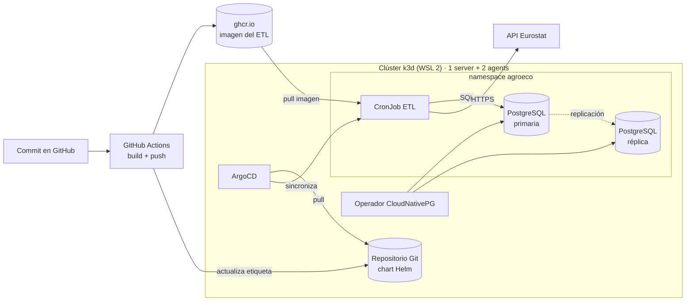

# Agroeco-EU K8s Platform

Migración del pipeline ETL de agricultura ecológica de la UE
([Agroeco-EU Cloud Pipeline](https://github.com/SamAnaya11/Agroeco-EU_Cloud-Pipeline),
serverless en Azure) a una plataforma Kubernetes con PostgreSQL gestionado
por operador, empaquetado con Helm, despliegue GitOps y CI/CD.

> Estado: en construcción (Fase 1 – Contenedor y Kubernetes básico).

## Qué hace

Cada mes, un CronJob de Kubernetes ejecuta el ETL:

1. **Extracción**: descarga cuatro tablas de la API pública de Eurostat
   (superficie ecológica por cultivo, % de SAU ecológica, operadores y ganadería).
2. **Transformación**: limpieza con pandas y modelo en estrella (2 dimensiones y 4 hechos).
3. **Carga**: PostgreSQL de alta disponibilidad (primaria y réplica) gestionado por CloudNativePG.

## Arquitectura



## Stack

_(Se completará con las versiones exactas verificadas en cada fase.)_

| Componente | Herramienta | Versión |
|------------|-------------|---------|
| Entorno | Ubuntu 26.04.1 LTS sobre WSL 2 | — |
| Contenedores | Docker Engine (WSL 2) | 29.10.0 |
| Kubernetes local | k3d / k3s | 5.9.0 / v1.37.2+k3s1 |
| Cliente Kubernetes | kubectl | v1.37.2 |
| Paquetes | Helm | v4.3.2 |
| Base de datos | CloudNativePG + PostgreSQL | — |
| GitOps | ArgoCD | — |
| CI/CD | GitHub Actions + ghcr.io | — |

## Requisitos

- Windows 11 con WSL 2 (Ubuntu) y systemd activado.
- Docker Engine, k3d, kubectl y Helm instalados **dentro de WSL**.
- Recursos asignados a WSL: ver `.wslconfig` en [Reproducción](#reproducción).

## Reproducción

_(Pendiente.)_

## Resultados de los experimentos

| Exp. | Qué demuestra | Resultado |
|------|---------------|-----------|
| A | Autocuración de pods | ✅ El Job sustituye al pod borrado sin intervención y termina `Complete` |
| B | Job/CronJob frente a Deployment | ✅ Como Deployment, el ETL termina bien (código 0) y aun así se reinicia en bucle (`CrashLoopBackOff`) |
| C | Failover de PostgreSQL | _pendiente_ |
| D | Mismo chart, distintos entornos | _pendiente_ |
| E | GitOps: corrección de drift y despliegue desde Git | _pendiente_ |
| F | Alerta ante fallo del Job | _pendiente_ |
| G | Limpieza completa | _pendiente_ |

### A · Autocuración

**Procedimiento.** Con el Job `agroeco-etl-manual` en ejecución, se borra su pod
(`kubectl delete pod`) y se observa con `kubectl get pods -w`.

**Resultado.**

- El pod borrado (`…-vv8b9`) pasa a `Terminating` y, en lugar de morir a
  mitad de la ejecución, termina en `Completed`.
- El controlador de Jobs crea por su cuenta un pod nuevo (`…-sn8mv`), que
  recorre `Pending` → `ContainerCreating` → `Running` → `Completed`.
- En los eventos del Job aparecen dos `SuccessfulCreate`, uno por pod, y la
  condición final `Completed`.
- Una segunda ejecución, con marcas de tiempo, confirma el comportamiento:

  | Momento (UTC) | Evento |
  |---------------|--------|
  | 14:17:29 | `Killing`: se borra el pod `…-zblft` |
  | 14:17:38 | `SuccessfulCreate`: el Job crea el pod `…-n8qb7` (**9 s después**) |
  | 14:17:47 | El Job queda `Completed` |

  Estado final del Job: `podReplacementPolicy: TerminatingOrFailed`,
  `succeeded: 1`, `failed: 1`.

Capturas: `08a_exp_A_autocuracion.png` (secuencia) y `08b_exp_A_autocuracion.png`
(eventos), de la primera ejecución; `08c_exp_A_tiempos.png` (eventos con hora y
política de reemplazo), de la segunda.

**Por qué el pod borrado llegó a terminar.** Al borrar un pod, Kubernetes envía
`SIGTERM` al proceso principal del contenedor y, si no ha salido al cabo del
periodo de gracia (`terminationGracePeriodSeconds`, 30 s por defecto), lo
mata con `SIGKILL`. En el contenedor del ETL, `python main.py` es el **PID 1**.
El kernel de Linux no aplica la acción por defecto de una señal (terminar) al
PID 1 de un espacio de nombres si el proceso no ha instalado un manejador, y
Python no instala ninguno para `SIGTERM`. Por eso la señal se ignoró y al ETL
le dio tiempo a acabar dentro de los 30 s de gracia. Si la ejecución hubiera
necesitado más tiempo, `SIGKILL` lo habría cortado. La integridad de los datos
estaría igualmente garantizada, porque toda la carga es una única transacción
y PostgreSQL deshace las transacciones que no llegan a confirmarse.

**Por qué el pod nuevo tarda unos 10 s.** La política por defecto
`podReplacementPolicy: TerminatingOrFailed` permite crear el reemplazo en cuanto
el pod borrado tiene `deletionTimestamp`, sin esperar a que termine. El retraso
no viene de esa política, sino del **retraso exponencial de reintentos** del Job:

1. Sin `podFailurePolicy`, el controlador cuenta un pod en borrado como
   **fallido en el mismo momento**, aunque después termine en `Succeeded`. Por
   eso el Job acaba con `failed: 1`, y ese intento consume uno de los
   reintentos de `backoffLimit`.
2. Tras un fallo, el controlador espera antes de crear el siguiente pod:
   10 s después del primer fallo, y el doble en cada fallo siguiente
   (20 s, 40 s…), hasta un máximo de 10 minutos.
3. Ese retraso se aplica a cualquier pod que falte, también a los de
   `TerminatingOrFailed`. El cálculo parte del momento en que se pidió el
   borrado, y eso cuadra con los ~9-10 s medidos.

Verificado en la [documentación de Jobs](https://kubernetes.io/docs/concepts/workloads/controllers/job/)
y en el código del controlador de la versión del clúster
([`pkg/controller/job/job_controller.go`, v1.37.2](https://github.com/kubernetes/kubernetes/blob/v1.37.2/pkg/controller/job/job_controller.go)):

```go
DefaultJobPodFailureBackOff = 10 * time.Second
// isPodFailed: "Count deleted Pods as failures to account for orphan Pods that
// never have a chance to reach the Failed phase."
return p.DeletionTimestamp != nil && p.Status.Phase != v1.PodSucceeded
// manageJob, antes de crear pods:
remainingTime = jobCtx.newBackoffRecord.getRemainingTime(jm.clock, DefaultJobPodFailureBackOff, MaxJobPodFailureBackOff)
```

### B · Job frente a Deployment

**Procedimiento.** Se despliega el mismo contenedor, con la misma
configuración y seguridad, como Deployment de 1 réplica
([`k8s/experimentos/b-etl-como-deployment.yaml`](k8s/experimentos/b-etl-como-deployment.yaml))
y se observa durante 33 minutos.

**Resultado.**

| Observación | Valor |
|-------------|-------|
| Última salida del contenedor | código `0` (`Completed`): el ETL termina **correctamente** |
| Estado del pod | `CrashLoopBackOff`, 8 reinicios en 33 min, con esperas crecientes entre reinicios |
| Eventos `BackOff` | 20 × `Back-off restarting failed container etl…` |
| Estado del Deployment | `READY 0/1`, `AVAILABLE 0` |
| Condiciones del Deployment | `Progressing=True (NewReplicaSetAvailable)`, `Available=False (MinimumReplicasUnavailable)` |
| Descargas de Eurostat | 4 por ejecución → unas 36 en total, y sigue creciendo |
| Job con el mismo contenedor | `Complete 1/1`: una ejecución, 4 descargas, sin reinicios |

Las dos condiciones resumen el problema. El despliegue en sí es correcto: el
ReplicaSet se creó (`Progressing=True`). Pero la aplicación nunca llega a
estar disponible (`Available=False`), porque el proceso termina cada vez.
Al borrar el Deployment desaparecen su ReplicaSet y su pod, y en el namespace
solo quedan los pods `Completed` de los Jobs.

Captura: `09_exp_B_job_vs_deployment.png`.

**Por qué.** Un Deployment mantiene N réplicas **siempre** en marcha y solo
admite `restartPolicy: Always`. Para él, que el proceso termine es un fallo,
sea cual sea su código de salida. Por eso el evento habla de *failed container*
aunque el ETL saliera con 0. El kubelet lo reinicia con esperas que se duplican
(10 s, 20 s, 40 s…, hasta 5 min), y el Deployment nunca llega a tener la
réplica disponible que se le pide.

| | Job / CronJob | Deployment |
|---|---|---|
| Pensado para | Trabajo que termina | Servicio que no debe terminar |
| Salida con código 0 | `Complete`: no hace nada más | Reinicio → `CrashLoopBackOff` |
| Salida con código ≠ 0 | Reintenta hasta `backoffLimit` y queda `Failed` (se puede alertar) | Reinicio sin fin |
| Efecto sobre Eurostat y PostgreSQL | Una descarga y una carga por ejecución | Descargas y, con la carga activa, recargas completas en bucle |
| Programación | El CronJob decide cuándo | Sin noción de horario |
| Estado visible | Distingue con claridad éxito y fallo | `CrashLoopBackOff` tanto si el ETL fue bien como si fue mal |

## Mejoras posibles

- **Cierre ordenado ante `SIGTERM`.** Instalar en `main.py` un manejador de
  `SIGTERM` que interrumpa el pipeline con una excepción controlada: la
  transacción en curso se deshace de forma explícita, se registra en el log
  que la ejecución se canceló y el proceso sale con un código distinto de 0.
  Hoy el ETL ignora la señal (es PID 1 sin manejador) y depende de terminar
  dentro del periodo de gracia o de ser cortado por `SIGKILL`.
- **`podFailurePolicy` en el Job.** Con una regla `Ignore` para la condición
  `DisruptionTarget`, los pods expulsados por el clúster (por ejemplo, al
  vaciar un nodo) no consumirían reintentos de `backoffLimit`. Como
  contrapartida, con `podFailurePolicy` la política de reemplazo pasa a ser
  `Failed`: el pod nuevo espera a que el anterior termine del todo.

## Comparación con la versión serverless en Azure

_(Pendiente.)_

## Capturas

Ver [docs/capturas/LEEME.md](docs/capturas/LEEME.md).

## Incidencias

Ver [docs/TROUBLESHOOTING.md](docs/TROUBLESHOOTING.md).
