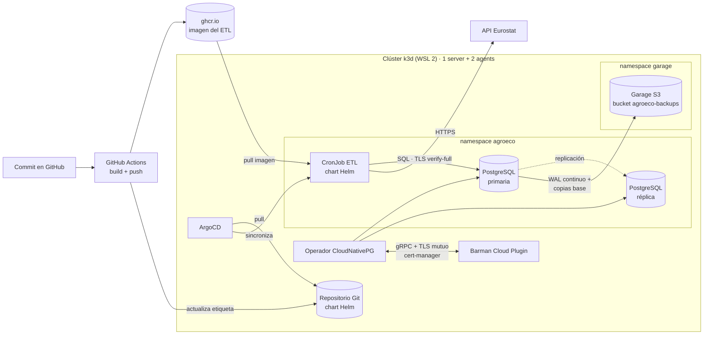

# Agroeco-EU K8s Platform

Migración del pipeline ETL de agricultura ecológica de la UE
([Agroeco-EU Cloud Pipeline](https://github.com/SamAnaya11/Agroeco-EU_Cloud-Pipeline),
serverless en Azure) a una plataforma Kubernetes con PostgreSQL gestionado
por operador, empaquetado con Helm, despliegue GitOps y CI/CD.

> Estado: en construcción (Fase 3 completada: chart de Helm propio, TLS `verify-full` y Experimento D; siguiente: Fase 4 – GitOps y CI/CD).

## Qué hace

Cada mes, un CronJob de Kubernetes ejecuta el ETL:

1. **Extracción**: descarga cuatro tablas de la API pública de Eurostat
   (superficie ecológica por cultivo, % de SAU ecológica, operadores y ganadería).
2. **Transformación**: limpieza con pandas y modelo en estrella (2 dimensiones y 4 hechos).
3. **Carga**: PostgreSQL de alta disponibilidad (primaria y réplica) gestionado por CloudNativePG.

La base de datos archiva su WAL de forma continua en un almacenamiento S3
(Garage) con el Barman Cloud Plugin. La restauración en un clúster nuevo está
probada y devuelve los mismos datos.

## Arquitectura



## Stack

_(Se completará con las versiones exactas verificadas en cada fase.)_

| Componente | Herramienta | Versión |
|------------|-------------|---------|
| Entorno | Ubuntu 26.04.1 LTS sobre WSL 2 | — |
| Contenedores | Docker Engine (WSL 2) | 29.10.0 |
| Kubernetes local | k3d / k3s | 5.9.0 / v1.37.2+k3s1 |
| Cliente Kubernetes | kubectl | v1.37.2 |
| Paquetes | Helm | v4.3.2 |
| Despliegue del ETL | Chart propio [`charts/agroeco-etl`](charts/agroeco-etl) | 0.1.0 (ETL 0.1.0) |
| Operador de base de datos | CloudNativePG (chart `cloudnative-pg`) | 1.30.2 (chart 0.29.2) |
| Base de datos | PostgreSQL (`ghcr.io/cloudnative-pg/postgresql:18.7-minimal-trixie`) | 18.7 |
| CLI de base de datos | Plugin `kubectl cnpg` | 1.30.2 |
| Certificados (requisito del plugin de backup) | cert-manager (chart OCI `quay.io/jetstack/charts/cert-manager`) | v1.21.3 |
| Backup de PostgreSQL | Barman Cloud Plugin (chart `plugin-barman-cloud`) | v0.16.0 (chart 0.9.0) |
| Almacenamiento S3 para backups | Garage (`dxflrs/garage`), un solo nodo | v2.5.0 |
| GitOps | ArgoCD | — |
| CI/CD | GitHub Actions + ghcr.io | — |

## Decisiones técnicas

- **Kubernetes 1.37 con CloudNativePG 1.30.** Según la
  [tabla de versiones de CloudNativePG](https://cloudnative-pg.io/documentation/current/supported_releases/),
  la serie 1.30 da soporte oficial a Kubernetes 1.34, 1.35 y 1.36. La 1.37
  figura como *«tested, but not supported»*: los mantenedores la prueban, pero
  no la cubren formalmente. Para este entorno de demostración se mantiene
  k3s v1.37.2, alineado con la versión estable actual de Kubernetes y de
  kubectl. **En producción se usaría una versión de Kubernetes con soporte
  oficial del operador.**
- **Kubernetes 1.37 con cert-manager 1.21.** El Barman Cloud Plugin necesita
  cert-manager para el TLS mutuo entre el operador y el plugin. Según la
  [tabla de versiones de cert-manager](https://cert-manager.io/docs/releases/),
  la serie 1.21 (última publicada, v1.21.3) da soporte oficial a Kubernetes
  de la 1.33 a la 1.36. La 1.37 todavía no figura en la tabla de ninguna
  versión publicada; la 1.22 está anunciada para noviembre de 2026. Se acepta
  como limitación del entorno de demostración, igual que con CloudNativePG
  1.30, y se actualizará a la 1.22 cuando se publique. **En producción se
  usaría una combinación con soporte oficial.**
- **Imagen `minimal` de PostgreSQL.** CloudNativePG 1.30.2 usa por defecto la
  imagen `system`. Esas imágenes están marcadas como obsoletas, porque incluyen
  Barman para el método `barmanObjectStore`, también obsoleto. Se fija la
  imagen `minimal`: es la más ligera y la recomendada para usar con
  plugins de backup como el Barman Cloud Plugin.
- **PostgreSQL 18, no 19.** CloudNativePG 1.30 admite PostgreSQL de la 15 a la 18.
- **Clúster PostgreSQL de 2 instancias en nodos distintos**
  ([`k8s/04-postgres-cluster.yaml`](k8s/04-postgres-cluster.yaml)): una
  primaria y una réplica en *streaming replication*, con antiafinidad
  obligatoria por nodo. La base de datos y su propietario se crean con el
  mismo Secret `basic-auth` que usa el ETL. El superusuario no tiene acceso
  por red. Este diseño local tiene dos limitaciones aceptadas:
  1. **Volumen atado a su nodo.** Con `local-path` el disco está en el nodo
     de la instancia: un pod borrado se recrea en el mismo nodo, pero si el
     nodo desapareciera esa instancia no podría moverse. En AKS se usaría un
     disco gestionado de Azure, que puede moverse entre nodos de la misma zona.
  2. **Memoria solicitada inferior al límite** (256 Mi frente a 512 Mi). En
     producción, CloudNativePG recomienda que sean iguales, para que
     Kubernetes no expulse a PostgreSQL cuando el nodo va justo de memoria.
     Aquí se reserva menos para ahorrar memoria en WSL.
- **Backup con el Barman Cloud Plugin y un recurso `ObjectStore`**
  ([`k8s/06-objectstore.yaml`](k8s/06-objectstore.yaml)). Se usa en lugar del
  bloque `barmanObjectStore` del Cluster, que está obsoleto. El destino es un
  recurso propio, que el Cluster solo referencia por su nombre
  (`spec.plugins`). La primaria archiva cada WAL en cuanto se completa, y las
  copias base se piden con recursos `Backup`. Juntos permiten restaurar hasta
  el final de una copia o hasta cualquier instante posterior. Retención de 7
  días y compresión gzip.
- **Garage de un solo nodo dentro del clúster**
  ([`k8s/05-garage.yaml`](k8s/05-garage.yaml)), como almacenamiento S3 en
  lugar de MinIO, que está archivado. Garage no publica un chart oficial, así
  que se despliega con manifiestos propios: un StatefulSet, porque el nodo
  guarda su identidad y su layout en el volumen, y un Service solo con la API
  S3. La API de administración no se activa, porque el CLI usa el canal RPC.
  El `rpc_secret` y la clave S3 se crean con `kubectl create secret`, y la
  clave pasa de `garage key create` al Secret sin mostrarse en pantalla.
  Este diseño local tiene tres limitaciones aceptadas:
  1. **Un solo nodo, en el mismo clúster que los datos.** Los objetos no
     tienen copias y el backup comparte destino con el clúster k3d. En un
     entorno real, el bucket estaría fuera del clúster, por ejemplo en Azure
     Blob Storage o en otro centro de datos.
  2. **HTTP sin TLS hacia Garage.** El tráfico no sale del clúster. En
     producción, la conexión con el almacenamiento iría por HTTPS.
  3. **Tamaño del volumen no garantizado.** `local-path` crea el volumen como
     una carpeta del nodo y no aplica el tamaño del PVC (2 Gi) como límite.
     Garage ve todo el disco virtual de WSL, y la capacidad de su layout
     (1 GB) es un peso para repartir los datos, no una cuota.
- **`primaryUpdateMethod: switchover`.** Cuando hay que recrear la primaria,
  el operador promueve antes la réplica ya actualizada en lugar de reiniciar
  la primaria en el sitio, que es el valor por defecto. Hay una excepción:
  al activar por primera vez el archivado de WAL con el plugin, la primaria
  se recrea en el sitio, porque sin el sidecar no podría completar el
  switchover ([TS-03](docs/TROUBLESHOOTING.md#ts-03--no-hay-switchover-al-activar-el-barman-cloud-plugin-pese-a-primaryupdatemethod-switchover)).
- **Chart de Helm solo para el ETL** ([`charts/agroeco-etl`](charts/agroeco-etl)).
  El chart contiene el ConfigMap, el CronJob y el Job de carga inicial. El
  Cluster de CloudNativePG, el ObjectStore, Garage, los namespaces y los
  Secrets quedan fuera, porque tienen otro ciclo de vida: un
  `helm uninstall` del ETL nunca puede borrar la base de datos, su backup ni
  sus credenciales. El chart solo recibe los nombres de los Secrets.
- **Una sola plantilla para el Job y el CronJob.** El pod (seguridad,
  recursos, variables y volúmenes) se define una vez en
  `templates/_helpers.tpl` y lo incluyen los dos objetos. La seguridad del
  pod no es configurable por valores: ningún entorno puede relajarla. El
  esquema `values.schema.json` rechaza valores mal escritos, una etiqueta
  `latest` y los modos TLS que no cifran o no lo exigen.
- **Carga inicial como hook `post-install`.** El `spec.template` de un Job no
  se puede modificar, así que un Job normal haría fallar `helm upgrade` en
  cuanto cambiara la plantilla. Como hook, se ejecuta una vez al instalar y
  Helm espera a que termine. Las ejecuciones posteriores se lanzan desde el
  CronJob (`kubectl create job --from=cronjob/…`), con la misma plantilla.
  Helm no borra los hooks al desinstalar: lo hace su TTL.
- **TLS con `verify-full` hacia PostgreSQL.** El pod monta solo la clave
  `ca.crt` del Secret `agroeco-pg-ca` que genera CloudNativePG, nunca
  `ca.key`, como carpeta y sin `subPath`, para que la renovación de la CA
  llegue al pod. `PGSSLROOTCERT` apunta a ella. Con `require` solo se monta la
  CA si se pide verificación: en libpq, una CA configurada convierte
  `require` en `verify-ca`.
- **Raw y processed en un volumen `emptyDir`.** Sustituyen a Blob Storage con
  la misma estructura por fecha. El destino persistente de los datos es
  PostgreSQL.

## Requisitos

- Windows 11 con WSL 2 (Ubuntu) y systemd activado.
- Docker Engine, k3d, kubectl y Helm instalados **dentro de WSL**.
- Recursos asignados a WSL: ver `.wslconfig` en [Reproducción](#reproducción).

## Reproducción

_(Pendiente.)_

## Validación de la carga

El mismo ETL se validó en dos entornos: primero con `docker run` contra un
PostgreSQL 18.7 local, con el sistema de archivos raíz en solo lectura como
en Kubernetes, y después como Job en el clúster contra CloudNativePG, a través
del Service `agroeco-pg-rw`.

| Tabla | Docker local | Kubernetes (primaria) |
|-------|-------------:|----------------------:|
| `dim_pais` | 28 | 28 |
| `dim_cultivo` | 17 | 17 |
| `fact_superficie` | 13 529 | 13 529 |
| `fact_pct_sau` | 620 | 620 |
| `fact_operadores` | 2 015 | 2 015 |
| `fact_ganaderia` | 1 395 | 1 395 |

- **Vista `v_superficie_total`:** superficie ecológica de España de
  2 944 904 ha en 2024, 2 991 881 ha en 2023 y 2 675 331 ha en 2022.
- **Duración del Job:** 13 s, de la descarga de Eurostat a la carga confirmada.
- **Réplica:** la consulta en `agroeco-pg-2` devuelve los mismos 13 529 registros
  de `fact_superficie` con `pg_is_in_recovery() = true`. Los datos se replican
  y la réplica es de solo lectura.
- **Conexión cifrada:** con `PGSSLMODE=require` y `log_connections=on`, el log
  de la primaria registra la conexión del ETL (en la Fase 3 pasa a
  `verify-full`; ver [Despliegue con Helm](#despliegue-con-helm)):

  ```
  connection authorized: user=agroeco database=agroeco application_name=agroeco-etl
  SSL enabled (protocol=TLSv1.3, cipher=TLS_AES_256_GCM_SHA384, bits=256)
  ```
- **Configuración aplicada sin interrupción:** activar `log_connections` en el
  Cluster no reinició ninguna instancia (`RESTARTS 0`). El operador recargó la
  configuración.

Capturas: `13a_consulta_datos.png` (recuentos, vista y réplica) y
`13b_conexion_tls.png` (conexión TLS en el log de PostgreSQL).

> Nota: consultado justo al terminar el log, el Job aún figuraba como
> `Running 0/1` y segundos después pasó a `Complete 1/1`. Desde Kubernetes
> 1.31, el controlador añade la condición final de un Job solo cuando todos
> sus pods han terminado del todo.

## Resultados de los experimentos

| Exp. | Qué demuestra | Resultado |
|------|---------------|-----------|
| A | Autocuración de pods | ✅ El Job sustituye al pod borrado sin intervención y termina `Complete` |
| B | Job/CronJob frente a Deployment | ✅ Como Deployment, el ETL termina bien (código 0) y aun así se reinicia en bucle (`CrashLoopBackOff`) |
| C | Failover de PostgreSQL | ✅ La réplica pasa a primaria 5,7 s después de borrar la primaria; el cliente vuelve a leer los mismos datos sin cambiar su configuración |
| D | Mismo chart, distintos entornos | ✅ Un solo chart y una sola imagen generan dos entornos: prod carga en PostgreSQL con `verify-full` cada mes; dev solo extrae y limpia, con el CronJob suspendido y menos memoria reservada, sin base de datos ni Secrets |
| E | GitOps: corrección de drift y despliegue desde Git | _pendiente_ |
| F | Alerta ante fallo del Job | _pendiente_ |
| G | Limpieza completa | _pendiente_ |

### A · Autocuración

**Procedimiento.** Con el Job `agroeco-etl-manual` en ejecución, se borra su pod
(`kubectl delete pod`) y se observa con `kubectl get pods -w`.

**Resultado.**

- El pod borrado (`…-vv8b9`) pasa a `Terminating` y, en lugar de morir a
  mitad de la ejecución, termina en `Completed`.
- El controlador de Jobs crea por su cuenta un pod nuevo (`…-sn8mv`), que
  recorre `Pending` → `ContainerCreating` → `Running` → `Completed`.
- En los eventos del Job aparecen dos `SuccessfulCreate`, uno por pod, y la
  condición final `Completed`.
- Una segunda ejecución, con marcas de tiempo, confirma el comportamiento:

  | Momento (UTC) | Evento |
  |---------------|--------|
  | 14:17:29 | `Killing`: se borra el pod `…-zblft` |
  | 14:17:38 | `SuccessfulCreate`: el Job crea el pod `…-n8qb7` (**9 s después**) |
  | 14:17:47 | El Job queda `Completed` |

  Estado final del Job: `podReplacementPolicy: TerminatingOrFailed`,
  `succeeded: 1`, `failed: 1`.

Capturas: `08a_exp_A_autocuracion.png` (secuencia) y `08b_exp_A_autocuracion.png`
(eventos), de la primera ejecución; `08c_exp_A_tiempos.png` (eventos con hora y
política de reemplazo), de la segunda.

**Por qué el pod borrado llegó a terminar.** Al borrar un pod, Kubernetes envía
`SIGTERM` al proceso principal del contenedor y, si no ha salido al cabo del
periodo de gracia (`terminationGracePeriodSeconds`, 30 s por defecto), lo
mata con `SIGKILL`. En el contenedor del ETL, `python main.py` es el **PID 1**.
El kernel de Linux no aplica la acción por defecto de una señal (terminar) al
PID 1 de un espacio de nombres si el proceso no ha instalado un manejador, y
Python no instala ninguno para `SIGTERM`. Por eso la señal se ignoró y al ETL
le dio tiempo a acabar dentro de los 30 s de gracia. Si la ejecución hubiera
necesitado más tiempo, `SIGKILL` lo habría cortado. La integridad de los datos
estaría igualmente garantizada, porque toda la carga es una única transacción
y PostgreSQL deshace las transacciones que no llegan a confirmarse.

**Por qué el pod nuevo tarda unos 10 s.** La política por defecto
`podReplacementPolicy: TerminatingOrFailed` permite crear el reemplazo en cuanto
el pod borrado tiene `deletionTimestamp`, sin esperar a que termine. El retraso
no viene de esa política, sino del **retraso exponencial de reintentos** del Job:

1. Sin `podFailurePolicy`, el controlador cuenta un pod en borrado como
   **fallido en el mismo momento**, aunque después termine en `Succeeded`. Por
   eso el Job acaba con `failed: 1`, y ese intento consume uno de los
   reintentos de `backoffLimit`.
2. Tras un fallo, el controlador espera antes de crear el siguiente pod:
   10 s después del primer fallo, y el doble en cada fallo siguiente
   (20 s, 40 s…), hasta un máximo de 10 minutos.
3. Ese retraso se aplica a cualquier pod que falte, también a los de
   `TerminatingOrFailed`. El cálculo parte del momento en que se pidió el
   borrado, y eso cuadra con los ~9-10 s medidos.

Verificado en la [documentación de Jobs](https://kubernetes.io/docs/concepts/workloads/controllers/job/)
y en el código del controlador de la versión del clúster
([`pkg/controller/job/job_controller.go`, v1.37.2](https://github.com/kubernetes/kubernetes/blob/v1.37.2/pkg/controller/job/job_controller.go)):

```go
DefaultJobPodFailureBackOff = 10 * time.Second
// isPodFailed: "Count deleted Pods as failures to account for orphan Pods that
// never have a chance to reach the Failed phase."
return p.DeletionTimestamp != nil && p.Status.Phase != v1.PodSucceeded
// manageJob, antes de crear pods:
remainingTime = jobCtx.newBackoffRecord.getRemainingTime(jm.clock, DefaultJobPodFailureBackOff, MaxJobPodFailureBackOff)
```

### B · Job frente a Deployment

**Procedimiento.** Se despliega el mismo contenedor, con la misma
configuración y seguridad, como Deployment de 1 réplica
([`k8s/experimentos/b-etl-como-deployment.yaml`](k8s/experimentos/b-etl-como-deployment.yaml))
y se observa durante 33 minutos.

**Resultado.**

| Observación | Valor |
|-------------|-------|
| Última salida del contenedor | código `0` (`Completed`): el ETL termina **correctamente** |
| Estado del pod | `CrashLoopBackOff`, 8 reinicios en 33 min, con esperas crecientes entre reinicios |
| Eventos `BackOff` | 20 × `Back-off restarting failed container etl…` |
| Estado del Deployment | `READY 0/1`, `AVAILABLE 0` |
| Condiciones del Deployment | `Progressing=True (NewReplicaSetAvailable)`, `Available=False (MinimumReplicasUnavailable)` |
| Descargas de Eurostat | 4 por ejecución → unas 36 en total, y sigue creciendo |
| Job con el mismo contenedor | `Complete 1/1`: una ejecución, 4 descargas, sin reinicios |

Las dos condiciones resumen el problema. El despliegue en sí es correcto: el
ReplicaSet se creó (`Progressing=True`). Pero la aplicación nunca llega a
estar disponible (`Available=False`), porque el proceso termina cada vez.
Al borrar el Deployment desaparecen su ReplicaSet y su pod, y en el namespace
solo quedan los pods `Completed` de los Jobs.

Captura: `09_exp_B_job_vs_deployment.png`.

**Por qué.** Un Deployment mantiene N réplicas **siempre** en marcha y solo
admite `restartPolicy: Always`. Para él, que el proceso termine es un fallo,
sea cual sea su código de salida. Por eso el evento habla de *failed container*
aunque el ETL saliera con 0. El kubelet lo reinicia con esperas que se duplican
(10 s, 20 s, 40 s…, hasta 5 min), y el Deployment nunca llega a tener la
réplica disponible que se le pide.

| | Job / CronJob | Deployment |
|---|---|---|
| Pensado para | Trabajo que termina | Servicio que no debe terminar |
| Salida con código 0 | `Complete`: no hace nada más | Reinicio → `CrashLoopBackOff` |
| Salida con código ≠ 0 | Reintenta hasta `backoffLimit` y queda `Failed` (se puede alertar) | Reinicio sin fin |
| Efecto sobre Eurostat y PostgreSQL | Una descarga y una carga por ejecución | Descargas y, con la carga activa, recargas completas en bucle |
| Programación | El CronJob decide cuándo | Sin noción de horario |
| Estado visible | Distingue con claridad éxito y fallo | `CrashLoopBackOff` tanto si el ETL fue bien como si fue mal |

### C · Failover de PostgreSQL

**Procedimiento.** Un pod cliente
([`k8s/experimentos/c-cliente-psql.yaml`](k8s/experimentos/c-cliente-psql.yaml))
abre cada 2 s una conexión nueva al Service `agroeco-pg-rw`, el mismo que
usa el ETL, con un tiempo máximo de conexión de 3 s. En cada vuelta registra
la IP del servidor que responde, si es primaria o réplica, y las filas de
`fact_superficie`. Con el cliente en marcha se borra el pod primario
(`kubectl delete pod agroeco-pg-1`).

**Situación inicial.** Primaria `agroeco-pg-1` (`10.42.0.16`, nodo `server-0`)
y réplica `agroeco-pg-2` (`10.42.1.6`, nodo `agent-1`).

**Cronología** (UTC). Las horas del borrado y del cliente son las de la
terminal. Las del failover salen de los eventos del Cluster y de
`.status.currentPrimaryTimestamp`.

| Hora | Δ | Qué ocurre | Fuente |
|------|---|------------|--------|
| 19:31:11 | — | Última respuesta de la primaria original: `10.42.0.16 primaria 13529` | cliente |
| 19:31:12 | 0 s | `kubectl delete pod agroeco-pg-1` | terminal |
| 19:31:13 | +1 s | Evento `FailingOver`: el operador detecta la caída de la primaria | eventos |
| 19:31:13 | +1 s | Cliente: `FATAL: the database system is shutting down` | cliente |
| 19:31:14 | +2 s | Evento `FailoverTarget`: el operador elige `agroeco-pg-2` | eventos |
| 19:31:15 | +3 s | Cliente: intento que acaba en `timeout expired` (3 s) | cliente |
| **19:31:17,73** | **+5,7 s** | **`agroeco-pg-2` ascendida a primaria** | `currentPrimaryTimestamp` |
| 19:31:20 | +8 s | Cliente: `10.42.1.6 primaria 13529`, y así cada 2 s, sin más errores | cliente |

**Resultado.**

- **Tiempo sin primaria: 5,7 s.** El cliente lo percibe como 8 s porque
  consulta a intervalos. El intento de las 19:31:15 empezó antes del ascenso
  y agotó su tiempo de conexión, y el siguiente llegó tras la pausa de 2 s.
  Con una aplicación que reintente más a menudo, el corte visible se
  acercaría a los 5,7 s.
- **Sin cambios en el cliente.** El Service `agroeco-pg-rw` mantiene la misma
  IP (`10.43.119.74`). El operador lo redirige a la nueva primaria, y el
  cliente, igual que el ETL, sigue usando el mismo nombre.
- **Sin pérdida de datos visible:** antes y después se leen las mismas
  13 529 filas.
- **Reincorporación automática.** Kubernetes vuelve a crear `agroeco-pg-1`
  en su nodo, donde está su volumen `local-path`. El operador lo reincorpora
  **como réplica** de la nueva primaria, en *streaming*, con el clúster en
  `Cluster in healthy state` y 2/2 instancias. La primaria se queda en
  `agroeco-pg-2`. CloudNativePG no deshace el failover, y si interesara se
  haría con un cambio controlado de primaria (`kubectl cnpg promote`).

**Escritura en la nueva primaria.** Con el cliente todavía leyendo, se
relanza el Job del ETL sin tocar su configuración:

- El Job termina `Complete 1/1` en 15 s. Se conecta a
  `agroeco-pg-rw` a las 20:14:21, sin reintentos, y entre las 20:14:21 y las
  20:14:24 borra, crea y recarga las 6 tablas (28, 17, 13 529, 620, 2 015 y
  1 395 filas).
- El log de `agroeco-pg-2`, la antigua réplica, registra la conexión del ETL
  a las 20:14:21,794 con `SSL enabled (protocol=TLSv1.3,
  cipher=TLS_AES_256_GCM_SHA384, bits=256)`. Es la nueva primaria la que
  recibe las escrituras, cifradas. Una línea anterior, de las 20:05:44, es
  de un primer lanzamiento repetido.
- **El cliente no ve nunca un estado intermedio.** Todas sus lecturas
  devuelven `10.42.1.6 primaria 13529`, sin errores ni recuentos parciales.
  El único intervalo mayor de lo normal va de las 20:14:22 a las 20:14:26.
  La hora de cada línea es la del inicio de la consulta, así que la de las
  20:14:22 esperó unos 2 s al bloqueo exclusivo que el ETL mantiene sobre la
  tabla, y respondió cuando terminaron las inserciones. Después vinieron los
  2 s de pausa del bucle. Como el ETL hace el `DROP`, el `CREATE` y los
  `INSERT` en **una sola transacción**, los demás clientes ven la tabla
  anterior completa o la nueva completa, nunca una tabla vacía o a medias.

**Balance del log del cliente.** El log completo tiene 3 199 lecturas, de
19:23:54 a 21:27:42 UTC, y solo **2 errores**: los dos del failover
(`the database system is shutting down` a las 19:31:13 y `timeout expired` a
las 19:31:15). Solo hay tres intervalos de más de 3 s entre lecturas:

| Intervalo | Duración | Causa |
|-----------|----------|-------|
| 19:31:15 → 19:31:20 | 5 s | Failover |
| 20:14:22 → 20:14:26 | 4 s | Espera al bloqueo durante la carga del ETL |
| 20:55:47 → 21:08:57 | 790 s | Suspensión del equipo |

> **Nota.** El hueco de 790 s no forma parte del failover. El PC entró en
> suspensión y con él se pausaron WSL y el clúster k3d. No hay ningún error
> antes ni después del hueco, y al volver el cliente siguió leyendo
> `10.42.1.6 primaria 13529`. Los nodos conservan su antigüedad, así que
> ninguno se reinició.

**Estado final.** Tras borrar el cliente, el clúster sigue en
`Cluster in healthy state`, con 2/2 instancias y `agroeco-pg-2` como
primaria. Las dos instancias están en `1/1 Running` con 0 reinicios y los
3 nodos están `Ready`. Los eventos del Job registran sus dos ejecuciones
completas: de 20:05:32 a 20:05:50 y de 20:14:12 a 20:14:27.

Capturas: `14a_exp_C_log_cliente.png` (log del cliente: corte y cambio de IP),
`14b_exp_C_cnpg_status.png` (estado tras el failover) y
`14c_exp_C_job_nueva_primaria.png` (Job relanzado contra la nueva primaria).

### D · Mismo chart, distintos entornos

**Procedimiento.** El chart `charts/agroeco-etl` se despliega con dos
archivos de valores:
- `values-prod.yaml`: la release del namespace `agroeco`, revisión 2 (ver
  [Despliegue con Helm](#despliegue-con-helm)).
- `values-dev.yaml`: una segunda release con el mismo nombre en el namespace
  `agroeco-dev` ([`k8s/00b-namespace-dev.yaml`](k8s/00b-namespace-dev.yaml)),
  con las mismas etiquetas de Pod Security `restricted`. En Helm el nombre de
  una release es único por namespace, así que las dos conviven.

Para no duplicar PostgreSQL en la memoria de WSL, dev no tiene base de datos:
el ETL solo extrae y limpia. Las dos ejecuciones nunca coinciden en el
tiempo. Al terminar, la release de dev se desinstala y se borra su namespace.

**1. Diferencias en los objetos generados**
(`diff -u` entre `helm template` con cada archivo de valores):

| Objeto | dev | prod |
|--------|-----|------|
| ConfigMap | `ETL_CARGAR_BD=false`, `ETL_NIVEL_LOG=DEBUG`; 3 claves, ninguna de PostgreSQL | `ETL_CARGAR_BD=true`, `ETL_NIVEL_LOG=INFO`; 8 claves, con `PGHOST`, `PGSSLMODE=verify-full` y `PGSSLROOTCERT` |
| CronJob | `0 7 * * 1`, `suspend: true`, historial 1/1 | `0 6 1 * *`, `suspend: false`, historial 3/3 |
| Pod | Sin credenciales ni CA; requests `100m` / `256Mi` | `PGUSER`/`PGPASSWORD` desde `agroeco-db-app`, CA `pg-ca` montada; requests `250m` / `512Mi` |
| Job de carga inicial | TTL 3 600 s | TTL 86 400 s |

No cambian los nombres, las etiquetas, la imagen `agroeco-etl:0.1.0`, la
seguridad del pod y del contenedor, los `emptyDir` ni el límite de memoria
de 1 Gi. El límite se mantiene a propósito: pandas procesa los mismos datos
en los dos entornos.

**2. Release de dev en el clúster.**
- `helm list -A`: `agroeco-etl` en `agroeco` (revisión 2) y en `agroeco-dev`
  (revisión 1), las dos `deployed` con `agroeco-etl-0.1.0`.
- Carga inicial de dev `Complete` en 11 s; el pod pasó a `Completed` en 8 s,
  frente a 15 s en prod, que además carga las 6 tablas. El log termina con
  `>>> 3. Carga en PostgreSQL omitida (ETL_CARGAR_BD=false)` y
  `Pipeline terminado correctamente`, sin ninguna conexión a PostgreSQL.
- CronJob de dev con `SUSPEND True`: solo se ejecuta a mano.

**3. Limpieza.** Después de `helm uninstall` en `agroeco-dev` quedaban solo
el Job `agroeco-etl-carga-inicial` (`Complete 1/1`) y el ConfigMap
`kube-root-ca.crt`, que Kubernetes crea en cada namespace. Se confirma así
que Helm no borra los hooks al desinstalar. El Job desapareció al borrar el
namespace, sin esperar a su TTL. La release de prod (revisión 2) y
`agroeco-pg` siguieron intactos.

**Nivel de log.** El nivel está configurado por entorno, pero **hoy no tiene
efecto visible**. El ETL lee `ETL_NIVEL_LOG` y lo aplica, pero su código no
emite mensajes DEBUG: el log de dev tiene 35 líneas, todas `INFO`
([TS-06](docs/TROUBLESHOOTING.md#ts-06--el-nivel-debug-de-dev-no-muestra-nada-más-que-prod)).
Los mensajes DEBUG llegarán en la Fase 4, con la imagen que construya
GitHub Actions.

**Conclusión.** Las diferencias entre entornos están solo en dos archivos de
valores revisables en Git, y el resto del despliegue es idéntico por
construcción. Promover un cambio de dev a prod es aplicar el mismo chart con
otro archivo, no mantener dos copias de los manifiestos.

Capturas: `19a1_exp_D_diff_configmap.png` y `19a2_exp_D_diff_cronjob.png`
(diff entre los entornos) y `19b_exp_D_release_dev.png` (las dos releases y
la ejecución de dev).

## Backup y restauración

Sin un backup externo, la alta disponibilidad no protege frente a borrados
o corrupción lógica, porque la réplica copia también los errores.

**Procedimiento.**
1. Se instalan cert-manager y el Barman Cloud Plugin, y se despliega Garage
   con el bucket `agroeco-backups` y una clave de lectura y escritura sin
   permisos de propietario.
2. Se conecta `agroeco-pg` al plugin (`spec.plugins`), que empieza a
   archivar el WAL de forma continua (`ContinuousArchiving=True`).
3. Se lanza un backup bajo demanda
   ([`k8s/07-backup.yaml`](k8s/07-backup.yaml)), con `method: plugin` y
   `target: prefer-standby`.
4. Se crea un clúster nuevo, `agroeco-pg-restore`
   ([`k8s/08-postgres-restore.yaml`](k8s/08-postgres-restore.yaml)), a partir
   de ese backup. No tiene `spec.plugins`, así que no escribe en el bucket.
5. Se comparan los datos con el original y se borra el clúster restaurado.

El contenido del bucket se lista con un Pod de un solo uso
([`k8s/utilidades/s3-listado.yaml`](k8s/utilidades/s3-listado.yaml)), porque el
CLI de Garage da el número de objetos pero no su lista.

**Backup** (`agroeco-pg-backup-manual`).

| Dato | Valor |
|------|-------|
| Instancia de origen | `agroeco-pg-1` (la réplica, por `prefer-standby`) |
| ID / duración | `20261123T210625`, de 21:06:26 a 21:06:35 UTC (9 s) |
| LSN inicial / final | `0/12000FE0` / `0/14000000` |
| Contenido del bucket | `base/20261123T210625/` (`data.tar.gz` de 4,4 MiB y `backup.info`) y los WAL `…0011`, `…0012` y `…0013` comprimidos con gzip: 5 objetos, 4,4 MiB |

**Restauración** (`agroeco-pg-restore`).

| Comprobación | Resultado |
|--------------|-----------|
| Estado | `Cluster in healthy state`, 1/1, primaria `agroeco-pg-restore-1` |
| Recuentos por tabla | 28, 17, 13 529, 620, 2 015 y 1 395: los mismos que el original |
| Recuperación terminada | `pg_is_in_recovery() = false`, en una línea temporal nueva (3) |
| Punto de recuperación | `00000003.history`: `2  0/14000000  no recovery target specified`. Se reprodujo el WAL hasta el final de la copia |
| Bucket después de la prueba | Los mismos 5 objetos. No aparece ninguna ruta `agroeco-pg-restore/` ni ningún archivo de la línea temporal 3 |

**Observaciones.**
- **El backup termina justo en un límite de segmento.** El LSN final
  `0/14000000` es el primer byte del segmento 0014, así que la copia solo
  necesita el WAL hasta el 0013, que ya estaba archivado. La base no tenía
  actividad, y en ese caso `archive_timeout` no cierra segmentos y
  `pg_switch_wal()` no hace nada. Desde PostgreSQL 17, `pg_walfile_name()`
  asigna un LSN situado en el límite al segmento que empieza en él, de ahí
  que `endWal` sea el 0014.
- **Sidecar temporal en el clúster restaurado.** El Job de recuperación y
  el primer pod de la instancia llevan el sidecar del plugin. Cuando termina
  el arranque, el operador recrea el pod sin él. Es un comportamiento
  previsto del plugin v0.16.0 para los clústeres que solo lo usan para
  recuperarse.
- Al activar el plugin hubo dos efectos documentados en
  [TS-03](docs/TROUBLESHOOTING.md#ts-03--no-hay-switchover-al-activar-el-barman-cloud-plugin-pese-a-primaryupdatemethod-switchover):
  la primaria se recreó sin switchover, y hubo 6 fallos inocuos al archivar
  el WAL 0011. Las otras dos sorpresas de la prueba están en
  [TS-04](docs/TROUBLESHOOTING.md#ts-04--kubectl-apply-responde-configured-sin-haber-cambios)
  (`configured` sin cambios) y
  [TS-05](docs/TROUBLESHOOTING.md#ts-05--falta-00000002history-en-el-archivo-de-wal)
  (historial de líneas temporales incompleto en el archivo).

Capturas: `16a_backup_completado.png` (backup `completed` y listado del
bucket) y `16b_restauracion.png` (clúster restaurado y recuentos).

## Despliegue con Helm

El ETL se despliega con el chart [`charts/agroeco-etl`](charts/agroeco-etl),
que sustituye a los manifiestos `k8s/01-configmap.yaml`, `02-job.yaml` y
`03-cronjob.yaml` de las fases 1 y 2. Esos manifiestos se retiran del
repositorio y siguen en el historial de Git.

**Validación sin tocar el clúster.**
- `helm lint --strict` con los valores por defecto, con `values-dev.yaml` y con
  `values-prod.yaml`: `0 chart(s) failed` en los tres.
- `helm template … | kubectl apply --dry-run=server`: el servidor acepta los
  tres objetos de dev y de prod y no da ningún aviso de Pod Security
  `restricted`.

**Migración desde los manifiestos.** Helm no instala sobre objetos que ya
existen y no pertenecen a ninguna release, así que antes se borraron el
CronJob y el ConfigMap antiguos. El Job `etl-prueba-cron` del Experimento B se
borró en cascada con el CronJob: su `ownerReference` apunta a él con
`controller=true`. `blockOwnerDeletion` está vacío porque
`kubectl create job --from` no lo activa, y solo cuenta en el borrado en
primer plano. PostgreSQL no se tocó.

**Revisiones.**

| Rev. | Cambio | Resultado |
|------|--------|-----------|
| 1 | `helm install` con `values-prod.yaml` y `--set postgres.tls.sslmode=require`: reproduce exactamente el comportamiento de los manifiestos | `deployed`. Carga inicial (hook) `Complete` en 17 s, con las 6 tablas (28, 17, 13 529, 620, 2 015, 1 395). ConfigMap con las mismas 7 claves que el antiguo; sin CA montada |
| 2 | `helm upgrade` solo con `values-prod.yaml`: `verify-full` | `deployed` (la 1 queda `superseded`). ConfigMap con 8 claves: `PGSSLMODE=verify-full` y `PGSSLROOTCERT=/etc/agroeco/pg-ca/ca.crt`. El CronJob monta `pg-ca` con solo `ca.crt` |

Sin `--reuse-values`, `helm upgrade` recalcula los valores desde el chart y
los archivos indicados, así que el `--set` de la revisión 1 no pasa a la 2,
que queda descrita entera por los archivos de Git.

**Verificación de `verify-full`.**
- **Caso positivo.** Ejecución manual desde el CronJob
  (`agroeco-etl-manual-tls`): `Complete` en 12 s, con las 6 tablas cargadas.
  El log de la primaria `agroeco-pg-2` registra a las 17:02:08 UTC
  `connection authorized: user=agroeco database=agroeco application_name=agroeco-etl SSL enabled (protocol=TLSv1.3, cipher=TLS_AES_256_GCM_SHA384, bits=256)`.
  Desde el servidor no se distingue `require` de `verify-full`; la prueba está
  en que el cliente se conectó con la verificación activada.
- **Prueba negativa**
  ([`k8s/experimentos/verify-full-negativa.yaml`](k8s/experimentos/verify-full-negativa.yaml)).
  Un Pod de un solo uso con `psql` y sin credenciales: la verificación TLS va
  antes de la autenticación, así que `fe_sendauth: no password supplied`
  significa «certificado aceptado» y no se lee ningún dato. La IP del Service
  `agroeco-pg-rw` (10.43.119.74) apunta al mismo servidor, pero no está en el
  SAN de su certificado.

| Caso | Host | Modo | Resultado |
|------|------|------|-----------|
| A | `agroeco-pg-rw` | `verify-full` + CA | `fe_sendauth: no password supplied`: certificado aceptado |
| B | `10.43.119.74` | `verify-full` + CA | **Rechazado**: `server certificate for "agroeco-pg-rw" (and 12 other names) does not match host name "10.43.119.74"` |
| C | `10.43.119.74` | `require`, sin CA | `fe_sendauth: no password supplied`: `require` acepta un servidor sin comprobar su nombre |

B y C se conectan al mismo servidor y solo cambia el modo. Es justo la
protección que añade la revisión 2: con `require`, el ETL hablaría con
cualquier servidor que respondiera en esa dirección con un certificado
cualquiera, y le enviaría los datos de la carga.

Capturas: `17a_helm_lint.png` y `17b_helm_template_cronjob.png` (lint y
CronJob generado), `18_helm_install_upgrade.png` (`helm history` con las
revisiones 1 y 2) y `18b_verify_full_negativa.png` (los tres casos de la
prueba negativa).

## Tareas pendientes

| Fase | Tarea | Motivo |
|------|-------|--------|
| 2 | Actualizar cert-manager a la serie 1.22 cuando se publique | La v1.21.3 no incluye Kubernetes 1.37 en su matriz de soporte (ver Decisiones técnicas). |
| 4 | Añadir mensajes DEBUG al ETL: URL y tamaño de cada descarga, y filas antes y después de cada limpieza | Hoy `ETL_NIVEL_LOG=DEBUG` no muestra nada más que `INFO` ([TS-06](docs/TROUBLESHOOTING.md#ts-06--el-nivel-debug-de-dev-no-muestra-nada-más-que-prod)). El cambio llega con la imagen que construya GitHub Actions y una nueva `appVersion` del chart. |
| 4 | Decidir cómo se ejecuta la carga inicial con ArgoCD | ArgoCD convierte el hook `post-install` en `PostSync` y lo ejecutaría en cada sincronización, no solo al instalar. |
## Mejoras posibles

- **Cierre ordenado ante `SIGTERM`.** Instalar en `main.py` un manejador de
  `SIGTERM` que interrumpa el pipeline con una excepción controlada: la
  transacción en curso se deshace de forma explícita, se registra en el log
  que la ejecución se canceló y el proceso sale con un código distinto de 0.
  Hoy el ETL ignora la señal (es PID 1 sin manejador) y depende de terminar
  dentro del periodo de gracia o de ser cortado por `SIGKILL`.
- **`podFailurePolicy` en el Job.** Con una regla `Ignore` para la condición
  `DisruptionTarget`, los pods expulsados por el clúster (por ejemplo, al
  vaciar un nodo) no consumirían reintentos de `backoffLimit`. Como
  contrapartida, con `podFailurePolicy` la política de reemplazo pasa a ser
  `Failed`: el pod nuevo espera a que el anterior termine del todo.

- **Backups programados.** Un recurso `ScheduledBackup` (por ejemplo,
  diario) sustituiría al backup bajo demanda, y la retención de 7 días del
  ObjectStore borraría las copias antiguas.
- **Prueba de restauración periódica.** Automatizar lo que aquí se hizo a
  mano: crear un clúster desde el último backup, comparar los recuentos y
  borrarlo. Un backup que no se restaura con regularidad no está probado.

## Comparación con la versión serverless en Azure

_(Pendiente.)_

## Capturas

Ver [docs/capturas/LEEME.md](docs/capturas/LEEME.md).

## Incidencias

Ver [docs/TROUBLESHOOTING.md](docs/TROUBLESHOOTING.md).
